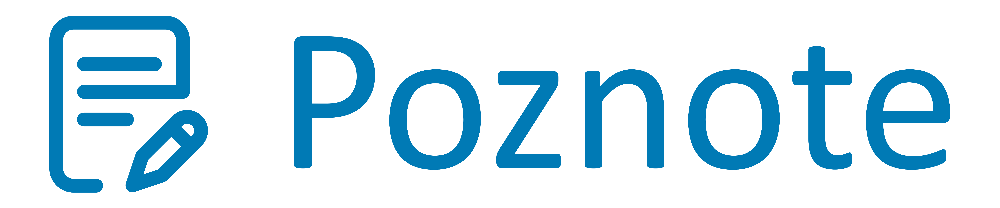

<!-- lang-selector -->
<p align="center">
  <a href="../README.md">English</a> ·
  <a href="README.fr.md">Français</a> ·
  <a href="README.de.md">Deutsch</a> ·
  <a href="README.es.md">Español</a> ·
  <a href="README.pt.md">Português</a> ·
  <a href="README.ru.md">Русский</a> ·
  <a href="README.zh-cn.md">简体中文</a> ·
  <a href="README.ko.md">한국어</a> ·
  <a href="README.ja.md">日本語</a> ·
  <a href="README.ca.md">Català</a> ·
  <b>Nederlands</b> ·
  <a href="README.vi.md">Tiếng Việt</a>
</p>
<!-- /lang-selector -->


<p align="center">
  
</p>

<h2 align="center">
Krachtig notities maken, zonder gedoe.
</h2>

<h3 align="center">
Een gratis, zelf te hosten, open-source alternatief voor Notion, Obsidian, Evernote of OneNote.
</h3>

<p align="center">
  <a href="https://poznote.com/video/poznote.mp4"></a>
</p>

<p align="center">
  
</p>

### Functies

Ontdek alle functies [hier](https://poznote.com/#features).

### Schermafbeeldingen

Bekijk alle schermafbeeldingen [hier](https://poznote.com/screenshots.html).

### Demo

https://demo.poznote.com

**Gebruikersnaam**: poznote<br>
**Wachtwoord**: poznote

### Geen zin om een server te beheren?

Een hostingbedrijf kan Poznote voor je draaien.<br>
[Vergelijk de hosts](https://poznote.com/hosting.html) of installeer direct:

<p>
  <a href="https://www.pikapods.com/pods?run=poznote"></a>
  <a href="https://calibernode.com/cloud-apps/poznote"></a>
</p>

### Zij schrijven over Poznote

https://poznote.com/press.html

### Discord

Word lid van de community om vragen te stellen, feedback te geven of de ontwikkeling te volgen:

https://discord.gg/ADyrkPVMAf

## Inhoudsopgave

- [Installatie](#installatie)
- [Toegang](#toegang)
- [Instellingen wijzigen](#instellingen-wijzigen)
- [Applicatie bijwerken](#applicatie-bijwerken)
- [Authenticatie](#authenticatie)
- [App-wachtwoorden](#app-wachtwoorden)
- [Notitietypen](#notitietypen)
- [Revisies](#revisies)
- [Personalisatie](#personalisatie)
- [Meerdere gebruikers](#meerdere-gebruikers)
- [Delen en samenwerken](#delen-en-samenwerken)
- [Snelkiezer](#snelkiezer)
- [Activiteitenlogboek](#activiteitenlogboek)
- [Webhooks](#webhooks)
- [Git-synchronisatie](#git-synchronisatie)
- [S3-opslag voor bijlagen](#opslag-van-bijlagen-in-s3)
- [Back-up / Exporteren](#back-up--exporteren)
- [Herstellen / Importeren](#herstellen--importeren)
- [Offline](#offline)
- [Meerdere instanties](#meerdere-instanties)
- [AI-assistent](#ai-assistent)
- [Transcriptie (spraak naar tekst)](#transcriptie-spraak-naar-tekst)
- [MCP-server](#mcp-server)
- [Applicaties](#applicaties)
- [Chrome-extensie](#chrome-extensie)
- [Delen naar Poznote op Android](#delen-naar-poznote-op-android)
- [API-documentatie](#api-documentatie)
- [Techstack](#technische-stack)

## Installatie

> De officiële image is multi-arch (linux/amd64, linux/arm64) en werkt op Windows/macOS via Docker Desktop, en ook op ARM64-apparaten zoals een Raspberry Pi, NAS-systemen enz.

Kies hieronder je favoriete installatiemethode:

<a id="windows"></a>
<details>
<summary><strong>🖥️ Windows</strong></summary>

#### Stap 1: Vereiste

Installeer en start [Docker Desktop](https://docs.docker.com/desktop/setup/install/windows-install/)

#### Stap 2: Poznote installeren

Maak een nieuwe map aan:

```powershell
mkdir poznote
```

Ga naar de Poznote-map:
```powershell
cd poznote
```

Maak het omgevingsbestand aan:

```powershell
curl -o .env https://raw.githubusercontent.com/timothepoznanski/poznote/main/.env.template
```

Bewerk het `.env`-bestand:

```powershell
notepad .env
```

Download het Docker Compose-configuratiebestand:

```powershell
curl -o docker-compose.yml https://raw.githubusercontent.com/timothepoznanski/poznote/main/docker-compose.yml
```

Download de nieuwste images van de Poznote-webserver en Poznote MCP:
```powershell
docker compose pull
```

Start de Poznote-containers:
```powershell
docker compose up -d
```

</details>

<a id="linux"></a>
<details>
<summary><strong>🐧 Linux</strong></summary>

#### Stap 1: Vereiste

1. Installeer [Docker engine](https://docs.docker.com/engine/install/)
2. Installeer [Docker Compose](https://docs.docker.com/compose/install/linux)

#### Stap 2: Poznote installeren

Maak een nieuwe map aan:
```bash
mkdir poznote
```

Ga naar de Poznote-map:
```bash
cd poznote
```

Maak het omgevingsbestand aan:
```bash
curl -o .env https://raw.githubusercontent.com/timothepoznanski/poznote/main/.env.template
```

Bewerk het `.env`-bestand:
```bash
vi .env
```

Download het Docker Compose-configuratiebestand:
```bash
curl -o docker-compose.yml https://raw.githubusercontent.com/timothepoznanski/poznote/main/docker-compose.yml
```

Download de nieuwste images van de Poznote-webserver en Poznote MCP:
```bash
docker compose pull
```

Start de Poznote-containers:
```bash
docker compose up -d
```

</details>

<a id="macos"></a>
<details>
<summary><strong>🍎 macOS</strong></summary>

#### Stap 1: Vereiste

Installeer en start [Docker Desktop](https://docs.docker.com/desktop/setup/install/mac-install/)

#### Stap 2: Poznote installeren

Maak een nieuwe map aan:
```bash
mkdir poznote
```

Ga naar de Poznote-map:
```bash
cd poznote
```

Download het omgevingsbestand:
```bash
curl -o .env https://raw.githubusercontent.com/timothepoznanski/poznote/main/.env.template
```

Bewerk het `.env`-bestand:
```bash
vi .env
```

Download het Docker Compose-configuratiebestand:
```bash
curl -o docker-compose.yml https://raw.githubusercontent.com/timothepoznanski/poznote/main/docker-compose.yml
```

Download de nieuwste images van de Poznote-webserver en Poznote MCP:
```bash
docker compose pull
```

Start de Poznote-containers:
```bash
docker compose up -d
```

</details>

<a id="cloud"></a>
<details>
<summary><strong>☁️ Cloud</strong></summary><br>

Geen zin om een server te beheren? Een hostingbedrijf kan Poznote voor je draaien en online houden. Bekijk [hier](https://poznote.com/hosting.html) de beschikbare hosts en hoe je ertussen kiest.

<p>
  <a href="https://www.pikapods.com/pods?run=poznote"></a>
  <a href="https://calibernode.com/cloud-apps/poznote"></a>
</p>

</details>

<a id="proxmox"></a>
<details>
<summary><strong>🗄️ Proxmox VE</strong></summary><br>

Op een Proxmox VE-host installeert het project Proxmox VE Community Scripts Poznote met één enkele opdracht in een eigen container, zonder Docker: het maakt een unprivileged Debian 13-LXC aan (standaard 1 vCPU, 512 MB RAM en een schijf van 4 GB) en serveert Poznote daarin met nginx en PHP.

Voer dit uit in de shell van de Proxmox-host:

```bash
bash -c "$(curl -fsSL https://raw.githubusercontent.com/community-scripts/ProxmoxVE/main/ct/poznote.sh)"
```

Poznote is daarna bereikbaar op `http://<container-ip>:8040`, met dezelfde standaardinloggegevens als bij elke andere installatie. Voer later `update` uit in de console van de container om bij te werken.

Dit script wordt geschreven en onderhouden door de community, niet door Poznote. Zie de [scriptpagina van Poznote](https://community-scripts.org/scripts/poznote) voor de opties en opmerkingen.

</details>

<a id="kubernetes"></a>
<details>
<summary><strong>☸️ Kubernetes met Helm</strong></summary>

#### Stap 1: Vereiste

Installeer [Helm](https://helm.sh/docs/intro/install/) en zorg dat je Kubernetes-context naar het cluster wijst waarop je Poznote wilt installeren.

#### Stap 2: Poznote installeren

Voeg de chartrepository van HelmForge toe:

```bash
helm repo add helmforge https://repo.helmforge.dev
```

Werk je lokale chartindex bij:

```bash
helm repo update
```

Installeer Poznote:

```bash
helm install poznote helmforge/poznote --namespace poznote --create-namespace
```

De Helm-chart van Poznote wordt onderhouden door de HelmForge-community als Kubernetes-native installatieoptie. Zie de [documentatie van de Poznote-chart van HelmForge](https://helmforge.dev/docs/charts/poznote) voor values, persistentie, het blootstellen van de service, probes, security contexts en andere instellingen voor productie.

</details>

<a id="rootless"></a>
<details>
<summary><strong>🔒 Rootless</strong></summary><br>

Poznote levert ook een rootless variant van de image die volledig als gebruiker zonder rechten draait (uid/gid `1000`) in plaats van als root, voor omgevingen die root in containers verbieden (Kubernetes met de restricted `PodSecurityStandard`, rootless Podman, `docker run --user`, enz.). Hij werkt precies zoals de standaardimage. De enige verschillen: hij luistert intern op poort `8080` en kan bij het opstarten de eigenaar van je datamap niet corrigeren.

#### Stap 1: Vereiste

1. Installeer [Docker engine](https://docs.docker.com/engine/install/)
2. Installeer [Docker Compose](https://docs.docker.com/compose/install/linux)

#### Stap 2: Poznote installeren

Maak een nieuwe map aan:
```bash
mkdir poznote
```

Ga naar de Poznote-map:
```bash
cd poznote
```

Maak de datamap aan en maak uid/gid `1000` er eigenaar van (**verplicht**: anders dan de standaardimage kan de rootless container deze eigenaar bij het opstarten niet zelf corrigeren):
```bash
mkdir -p data
sudo chown -R 1000:1000 data
```

`sudo` is hier vaak niet nodig: als je gebruiker al uid `1000` heeft, kun je de `chown` overslaan, en met rootless Podman/Docker kan hij zonder root draaien, zie [Running rootless](TROUBLESHOOTING.nl.md#running-rootless).

Maak het omgevingsbestand aan:
```bash
curl -o .env https://raw.githubusercontent.com/timothepoznanski/poznote/main/.env.template
```

Bewerk het `.env`-bestand:
```bash
vi .env
```

Download het rootless Docker Compose-configuratiebestand:
```bash
curl -o docker-compose.rootless.yml https://raw.githubusercontent.com/timothepoznanski/poznote/main/docker-compose.rootless.yml
```

Download de nieuwste rootless images van de Poznote-webserver en Poznote MCP:
```bash
docker compose -f docker-compose.rootless.yml pull
```

Start de Poznote-containers:
```bash
docker compose -f docker-compose.rootless.yml up -d
```

Om een bestaande Poznote-instantie naar de rootless variant over te zetten, of voor meer details, zie [Running rootless](TROUBLESHOOTING.nl.md#running-rootless) in de gids voor probleemoplossing.

</details>

<br>

> Loop je tegen installatieproblemen aan, zie dan de [gids voor probleemoplossing](TROUBLESHOOTING.nl.md).

## Toegang

Open Poznote na de installatie in je webbrowser:

[http://localhost:8040](http://localhost:8040)


- Gebruikersnaam: `admin_change_me`
- Wachtwoord: `admin`
- Poort: `8040`

Hernoem het standaardbeheerdersaccount en wijzig het standaardwachtwoord na de eerste keer inloggen.

## Instellingen wijzigen

De meeste dagelijkse instellingen wijzig je in de interface van Poznote. Gebruik het `.env`-bestand alleen voor deployment- en runtimewaarden die worden gelezen wanneer de containers starten.

<details>
<summary><strong>Gebruik het <code>.env</code>-bestand voor</strong></summary>
<br>

- `HTTP_WEB_PORT`
- `POZNOTE_OIDC_CLIENT_ID`
- `POZNOTE_OIDC_CLIENT_SECRET`
- `POZNOTE_OIDC_DISABLE_NORMAL_LOGIN`
- Optionele runtime-overrides zoals `POZNOTE_MCP_PORT` en `POZNOTE_DEBUG`
- `POZNOTE_PHP_FPM_MAX_CHILDREN` om het aantal gelijktijdige PHP-verzoeken te wijzigen (standaard 10) op een drukke instantie, zie de [gids voor probleemoplossing](TROUBLESHOOTING.nl.md#the-app-stops-answering-under-load)
- `POZNOTE_PHP_MEMORY_LIMIT` om de PHP-geheugenlimiet per verzoek te wijzigen, in MB (standaard 512), zie de [gids voor probleemoplossing](TROUBLESHOOTING.nl.md#a-request-runs-out-of-memory)
- `POZNOTE_LISTEN_PORT` om de poort te wijzigen waarop de webserver in de container luistert (standaard 80), alleen nodig met `network_mode: host`, zie de [gids voor probleemoplossing](TROUBLESHOOTING.nl.md#running-with-host-network)
- `POZNOTE_SETTINGS_PASSWORD` om een extra wachtwoord te vragen voordat de pagina Instellingen opent, standaard leeg
- `POZNOTE_MCP_AUTH_TOKEN` om een bearer-token van MCP-clients te eisen, en de andere `POZNOTE_MCP_*`-variabelen, die bepalen hoe clients inloggen en welke tools ze kunnen gebruiken, zie [MCP-server](#mcp-server)

</details>

<details>
<summary><strong>Gebruik de interface voor</strong></summary>
<br>

- Beheer- en globale instellingen, zoals de instellingen van de OIDC-provider, het inschakelen van Git-synchronisatie, importlimieten en het uploaden van aangepaste CSS
- Gebruikers- en profielinstellingen, zoals wachtwoorden van lokale accounts, thema, lettergroottes, sortering van notities, achtergrond van de werkruimte en verborgen interface-elementen

</details>


### Systeeminstellingen wijzigen (`.env`)

Ga naar je Poznote-map:
```bash
cd poznote
```

Stop de draaiende Poznote-containers:
```bash
docker compose down
```

Bewerk je `.env`-bestand met je favoriete teksteditor (bijv. `nano .env` of `notepad .env`).

Sla het bestand op en start de containers opnieuw om de wijzigingen toe te passen:
```bash
docker compose up -d
```

## Applicatie bijwerken

Ga naar je Poznote-map:
```bash
cd poznote
```

Stop de draaiende containers voordat je bijwerkt:
```bash
docker compose down
```

Download de nieuwste Docker Compose-configuratie:
```bash
curl -o docker-compose.yml https://raw.githubusercontent.com/timothepoznanski/poznote/main/docker-compose.yml
```

Download de nieuwste `.env.template`:
```bash
curl -o .env.template https://raw.githubusercontent.com/timothepoznanski/poznote/main/.env.template
```

Vergelijk `.env.template` met sdiff en voeg zo nodig nieuwe variabelen toe aan je `.env`-bestand:
```bash
sdiff .env .env.template
```

Download de nieuwste images van de Poznote-webserver en Poznote MCP:
```bash
docker compose pull
```

Start de bijgewerkte containers:
```bash
docker compose up -d
```

Je gegevens blijven bewaard in de map `./data` en worden niet geraakt door de update.

### Bètaversies

Bètaversies brengen nieuwe functies voordat ze als stabiele versie uitkomen, en staan als pre-releases op de [releasepagina](https://github.com/timothepoznanski/poznote/releases). Ze worden gepubliceerd onder de tag `latest-and-beta`, die altijd naar de nieuwste versie wijst, bèta of stabiel.

Om ze te gebruiken, wijzig je de twee `image`-regels van je `docker-compose.yml` en laat je de rest van het bestand zoals het is:
```yaml
services:
  webserver:
    image: ghcr.io/timothepoznanski/poznote:latest-and-beta
    ...
  mcp-server:
    image: ghcr.io/timothepoznanski/poznote-mcp:latest-and-beta
    ...
```

Met de [rootless](#rootless) variant wordt de webserverimage in `docker-compose.rootless.yml` `poznote:latest-and-beta-rootless`, en de MCP-image blijft dezelfde `poznote-mcp:latest-and-beta`.

Download de images en start de containers opnieuw:
```bash
docker compose pull
docker compose up -d
```

*   **Voordat je overstapt:** een bèta kan nog bugs bevatten, dus maak eerst een [back-up](#back-up--exporteren). Problemen kun je melden in de [GitHub-issues](https://github.com/timothepoznanski/poznote/issues) of op [Discord](https://discord.gg/ADyrkPVMAf).
*   **Updates:** elke `docker compose pull` haalt dan de nieuwste bèta op, of de stabiele versie zodra die uitkomt. De updateprocedure hierboven downloadt een nieuwe `docker-compose.yml` die weer de stabiele tags gebruikt, dus wijzig na die stap de twee `image`-regels opnieuw.
*   **Terug naar stabiel:** een bèta kan de database wijzigen, dus teruggaan naar een oudere stabiele versie werkt mogelijk niet. Wacht op de volgende stabiele versie, die de wijzigingen van de bèta bevat, en volg dan de updateprocedure hierboven.

## Authenticatie

Poznote ondersteunt meerdere authenticatiemethoden, waaronder lokale accounts en externe identiteitsproviders. Apps en extensies die met de REST API praten, gebruiken [app-wachtwoorden](#app-wachtwoorden), aparte inloggegevens die in de volgende sectie worden beschreven.

<details>
<summary><strong>Authenticatie met lokale accounts</strong></summary>
<br>

Poznote authenticeert gebruikers tegen hun profiel met een gebruikersnaam of e-mailadres en een wachtwoord.


#### Standaardaccount

Bij een nieuwe installatie maakt Poznote één actief beheerdersprofiel aan:

- Gebruikersnaam: `admin_change_me`
- Wachtwoord: `admin`

Wijzig het standaardwachtwoord en hernoem het account na de eerste keer inloggen.

#### Wachtwoordbeheer

Wachtwoorden worden beheerd via de webinterface van Poznote, niet via `.env`:

- Gebruikers kunnen hun eigen wachtwoord wijzigen via **Instellingen > Wachtwoord wijzigen**.
- Beheerders kunnen voor elke gebruiker een eigen wachtwoord instellen of het terugzetten naar de standaardwaarde via **Instellingen > Beheertools > Gebruikersbeheer**.
- De optie **Ingelogd blijven** bewaart de sessie standaard 30 dagen. Een beheerder kan dat wijzigen via **Instellingen > Beheertools > Gebruikers en toegang**, van 1 tot 400 dagen. Het geldt alleen voor inloggen met een wachtwoord, want een SSO-aanmelding krijgt die cookie nooit.
- Een aanmelding duurt 7 dagen zonder activiteit en blijft bestaan als je de browser sluit. Dit is wat een SSO-aanmelding vasthoudt, die nooit een ingelogd-blijven-cookie krijgt, zodat een account dat bij de identiteitsprovider is uitgeschakeld de toegang verliest wanneer zijn sessie verloopt. Stel `POZNOTE_SESSION_LIFETIME_DAYS` in `.env` in voor een ander geheel aantal dagen, van 1 tot 400.
- Een wachtwoord wijzigen maakt de bestaande ingelogd-blijven-cookies van die gebruiker ongeldig.
- **Instellingen > Mijn account > Verbonden apparaten** toont de browsers die nu op je account zijn ingelogd, met hun laatste activiteit, en logt de browsers uit die je niet meer gebruikt.

#### Tweestapsverificatie

Elke gebruiker kan tweestapsverificatie (TOTP) inschakelen via **Instellingen > Tweestapsverificatie**. Na het wachtwoord vraagt het inlogformulier dan om een 6-cijferige code uit een authenticator-app (Aegis, Google Authenticator, 1Password, Bitwarden...).

- Bij het instellen verschijnen een QR-code, getekend in de browser, en tien eenmalige herstelcodes die je bewaart voor het geval je telefoon kwijtraakt.
- Het beschermt inloggen met een wachtwoord. Een SSO-login wordt overgelaten aan de identiteitsprovider en zijn eigen tweede factor.
- Zolang het aanstaat, accepteert de REST API het accountwachtwoord niet meer op zichzelf: geef clients een [app-wachtwoord](#app-wachtwoorden), of stuur de huidige code mee in de header `X-Poznote-OTP`.
- Een beheerder kan het uitschakelen voor een gebruiker die zowel zijn apparaat als zijn herstelcodes kwijt is, via **Instellingen > Beheertools > Gebruikersbeheer** (wachtwoordvenster).
- Een beheerder kan het verplicht maken voor elk account dat met een wachtwoord inlogt, via **Instellingen > Beheertools > Tweestapsverificatie verplichten**. Een account zonder tweestapsverificatie stelt het in bij de volgende keer inloggen (QR-code en eerste code op de inlogpagina), sessies die zonder geopend zijn, worden beëindigd, en de eigenaar kan het niet meer uitschakelen. SSO-aanmeldingen vallen hier niet onder.
- Het in- of uitschakelen maakt de bestaande ingelogd-blijven-cookies van die gebruiker ongeldig.

#### Standaardwachtwoorden

- Beheerdersaccounts: `admin`
- Standaardgebruikersaccounts: `user`

Zolang een gebruiker zijn wachtwoord nog niet heeft gewijzigd, wordt de standaardwaarde hierboven gebruikt. Zodra een wachtwoord via de interface is gewijzigd, wordt een veilige bcrypt-hash in de database opgeslagen, die voorrang krijgt.

</details>

<a id="oidc"></a>
<details>
<summary><strong>OIDC / SSO-authenticatie (optioneel)</strong></summary>
<br>

Poznote ondersteunt OpenID Connect (authorization code + PKCE) voor integratie met single sign-on. Zo kunnen gebruikers inloggen via externe identiteitsproviders zoals Auth0, Keycloak, Azure AD of Google Identity.

#### Hoe het werkt

1. De inlogpagina toont een knop `[Provider Name]` wanneer OIDC is ingeschakeld.
2. Gebruikers authenticeren met de OIDC-authorization-code-flow, beveiligd met PKCE.
3. De toegang kan worden beperkt met toegestane groepen en, indien nodig, een verouderde lijst van toegestane gebruikers.
4. Na de authenticatie koppelt Poznote de identiteit via `sub` (`oidc_subject`), daarna via een geverifieerd e-mailadres (ingesteld door een beheerder of gesynchroniseerd vanuit de provider, hoofdletters maken niet uit). Een bestaand profiel wordt nooit via zijn gebruikersnaam gekoppeld: om er een te koppelen bij de eerste SSO-login, geef je het het e-mailadres dat de provider stuurt, of plak je zijn OIDC-subject, in **Instellingen > Beheertools > Gebruikersbeheer**. Een geweigerde eerste login schrijft het subject dat je moet plakken in het logboek.
5. Als het automatisch aanmaken van gebruikers is ingeschakeld en er geen profiel overeenkomt, maakt Poznote er automatisch een aan. Zo'n profiel heeft **helemaal geen wachtwoord**: het heeft nooit de overdracht van de eerste inloggegevens doorlopen die een beheerder doet bij het aanmaken van een account, dus het reageert niet op het standaardwachtwoord. Inloggen gaat via de provider, of een beheerder stelt een expliciet wachtwoord in via **Instellingen > Beheertools > Gebruikersbeheer**.
6. Als `POZNOTE_OIDC_DISABLE_NORMAL_LOGIN=true`, wordt het formulier met gebruikersnaam en wachtwoord verborgen en werkt de inlogpagina alleen nog met SSO.
7. REST API-clients kunnen authenticeren met `Authorization: Bearer <OIDC JWT>` wanneer OIDC is ingeschakeld. Poznote valideert de JWKS van de provider, de issuer, de vervaldatum, de audience en de ingestelde toegangsregels.
8. Clients die helemaal geen OIDC-flow kunnen uitvoeren (browserextensie, mobiele app, scripts) gebruiken in plaats daarvan een [app-wachtwoord](#app-wachtwoorden), dat elke gebruiker in zijn eigen instellingen aanmaakt.
9. [Tweestapsverificatie](#tweestapsverificatie) dekt alleen het wachtwoordformulier: een SSO-login vraagt nooit om de Poznote-code. Eis in plaats daarvan een tweede factor bij de identiteitsprovider. Een gebruiker die zowel een wachtwoord als een SSO-identiteit heeft, houdt beide toegangswegen, en de SSO-weg is maar zo sterk als het beleid van de provider.

#### Configuratie

OIDC configureer je in de **beheerinterface**: ga naar **Instellingen > Beheertools > OIDC / SSO**.

De meeste instellingen (ingeschakeld, issuer, naam van de provider, scopes, toegangsbeheer, toegestane groepen/gebruikers, automatisch aanmaken van gebruikers, gedrag van HTTP Basic Auth, enz.) worden op deze pagina beheerd en in de database opgeslagen.

Voor authenticatie met een Bearer-JWT op de REST API stel je **API JWT-audience** in als je provider access tokens uitgeeft voor een aparte API-audience. Is dit veld leeg, dan accepteert Poznote de ingestelde OIDC-client-ID als JWT-audience.

De volgende instellingen blijven in het `.env`-bestand:

```bash
POZNOTE_OIDC_CLIENT_ID=your_client_id
POZNOTE_OIDC_CLIENT_SECRET=your_client_secret
POZNOTE_OIDC_DISABLE_NORMAL_LOGIN=false
```

Gebruik `POZNOTE_OIDC_DISABLE_NORMAL_LOGIN=true` als je het lokale formulier met gebruikersnaam en wachtwoord wilt verbergen en alleen inloggen via SSO wilt toestaan. Dit is de enige schakelaar die authenticatie met een wachtwoord blokkeert: hij verwijdert het formulier, weigert wachtwoord-POSTs aan de serverkant en verbergt de instelling "Wachtwoord wijzigen".

> **Herstellen na een storing van de identiteitsprovider.** Alleen SSO betekent precies dat: zolang `POZNOTE_OIDC_DISABLE_NORMAL_LOGIN=true`, kan niemand met een wachtwoord inloggen, ook beheerders niet, dus er is geen nooduitgang in de browser. Dat is bewust zo, want een aanvaller die een beheerdersaccount heeft overgenomen, kan het inloggen met een wachtwoord dan niet weer inschakelen om zichzelf blijvend toegang te geven. Herstel vereist toegang tot de server: zet `POZNOTE_OIDC_DISABLE_NORMAL_LOGIN=false` in `.env`, start de container opnieuw en log in met een lokaal wachtwoord. Zorg voordat je alleen SSO inschakelt dat minstens één beheerdersaccount een expliciet wachtwoord heeft (**Instellingen > Beheertools > Gebruikersbeheer**), anders helpt het terugzetten van de schakelaar niet. Let op: een beheerdersprofiel dat automatisch door OIDC is aangemaakt, heeft geen wachtwoord totdat er een wordt ingesteld.

> **Belangrijke wijziging:** eerdere OIDC-instellingen in `.env` worden niet meer gelezen, behalve `POZNOTE_OIDC_CLIENT_ID`, `POZNOTE_OIDC_CLIENT_SECRET` en `POZNOTE_OIDC_DISABLE_NORMAL_LOGIN`. Voer na de upgrade de andere OIDC-instellingen opnieuw in op de beheerpagina.

#### URL's om bij je identiteitsprovider te registreren

Wanneer je de applicatie (client) bij je identiteitsprovider aanmaakt, registreer je de eerste URL hieronder als redirect-URI (ook wel callback-URL genoemd), en de tweede als redirect-URI na uitloggen als je provider erom vraagt:

```text
https://YOUR_SERVER/oidc_callback.php
https://YOUR_SERVER/login.php
```

Poznote bouwt beide op uit de hostnaam waarop het verzoek binnenkomt, altijd met `https://`. Heeft je provider iets anders nodig, stel dan **Redirect-URI** of **Redirect-URI na uitloggen** in, in de sectie Geavanceerd van de OIDC-beheerpagina, en registreer precies die waarde.

De discovery-URL hoef je meestal niet in te vullen: Poznote plakt `/.well-known/openid-configuration` achter de **Issuer-URL**. Met Authentik is de issuer bijvoorbeeld `https://AUTHENTIK_HOST/application/o/APPLICATION_SLUG/`. Stel de **Discovery-URL** alleen in als je provider dat document ergens anders publiceert.

#### Voorbeeld van toegangsbeheer (groepen + automatisch aanmaken)

Stel op de OIDC-beheerpagina het volgende in:
- **Groepen-claim:** `groups`
- **Toegestane groepen:** `poznote`
- **Gebruikersprofielen automatisch aanmaken bij de eerste OIDC-login:** ingeschakeld

Als automatisch aanmaken is ingeschakeld, genereert Poznote een gebruikersnaam uit de OIDC-claims (`preferred_username`, `nickname`, het lokale deel van het e-mailadres, `name`, daarna `sub`) en slaat het het OIDC-subject op in het aangemaakte profiel. Als een bestaand profiel dat nog nooit met SSO heeft ingelogd al die `preferred_username` draagt, wordt de login geweigerd in plaats van er een tweede profiel naast aan te maken: geef dat profiel het e-mailadres dat de provider stuurt, of zijn OIDC-subject, zodat het wordt gekoppeld.

</details>

## App-wachtwoorden

Apps kunnen niet via een identiteitsprovider inloggen zoals een browser dat kan. Een **app-wachtwoord** is een apart wachtwoord dat je voor één client aanmaakt (de browserextensie, een telefoon, een script) en op elk moment kunt intrekken, zodat je nooit je accountwachtwoord hoeft weg te geven.

Maak er een aan via **Instellingen > App-wachtwoorden**: geef het een naam, eventueel een vervaldatum, en kopieer het gegenereerde geheim. Het wordt één keer getoond en daarna nooit meer. Vul vervolgens in de client je gewone gebruikersnaam in, en het app-wachtwoord waar om een wachtwoord wordt gevraagd. Het gaat mee als gewone HTTP Basic Auth, dus elke bestaande client werkt zoals hij is:

```bash
curl -u 'username:pzn_2f7c…' https://YOUR_SERVER/api/v1/notes
```

Een app-wachtwoord geeft alleen toegang tot de REST API, en alleen voor zijn eigen profiel: het kan de webinterface niet openen, geen beheer-endpoint aanroepen, je wachtwoord niet wijzigen en je account niet beheren, ook niet als het account een beheerder is. Een gelekt app-wachtwoord legt dus de notities van één account bloot en niets meer, en door het in te trekken is het lek gedicht. Op een instantie met alleen SSO, waar accounts die door OIDC zijn aangemaakt helemaal geen wachtwoord hebben, is het de enige inloggegevens die de API via Basic Auth accepteert.

De volledige lijst met beperkingen en de endpoints om app-wachtwoorden te beheren staan in de [REST API-documentatie](API-REST.md#authentication).

## Notitietypen

Poznote heeft meerdere notitietypen, elk afgestemd op een andere manier van werken. Rich text en Markdown zijn de twee notitieformaten; de andere hieronder bouwen daarop voort.

<details>
<summary><strong>Rich text-notities</strong></summary>
&nbsp;

*   **Editor:** Direct WYSIWYG-bewerken (What You See Is What You Get).
*   **Opslag:** Opgeslagen als `.html`-bestanden in de datamap van de gebruiker. Omdat het standaard HTML is, kun je ze direct in elke webbrowser openen.
*   **Exclusieve functies:**
    *   **Rijke opmaak:** Ingebouwde ondersteuning voor tekstkleuren, markeren en standaard HTML-elementen.
    *   **Interactieve interface:** Elementen direct in de editor bewerken.
</details>

<details>
<summary><strong>Markdown-notities</strong></summary>
&nbsp;

*   **Editor:** Editor voor Markdown-syntaxis met realtime voorbeeld.
*   **Opslag:** Opgeslagen als `.md`-bestanden in de datamap van de gebruiker.
*   **Exclusieve functies:**
    *   **Mermaid-diagrammen:** Ingebouwde ondersteuning voor het maken van diagrammen (stroomdiagrammen, sequentiediagrammen, enz.) via codeblokken ` ```mermaid `.
    *   **Wiskundige formules:** Uitgebreide LaTeX-ondersteuning voor wiskundige formules met de syntaxis `$ inline $` en `$$ block $$`.
    *   **Overdraagbaarheid:** Standaard Markdown-formaat, compatibel met elke externe editor of statische sitegenerator.
</details>

<details>
<summary><strong>Takenlijsten</strong></summary>
&nbsp;

*   **Gebruik:** Beheer taken en projecten met interactieve checklists.
*   **Werkwijze:** Volg de voortgang met selectievakjes die je direct in de editor of in de notitielijst kunt aan- en uitvinken. Een voortgangsbalk toont hoe ver elke lijst is.
*   **Taakopties:** Elke taak kan een vervaldatum hebben met een optionele tijd, een herinnering die op het vervaltijdstip afgaat, en een prioriteit (hoog, gemiddeld of laag, weergegeven in rood, oranje of groen), en kan naar een andere lijst worden verplaatst.
*   **Pagina Taken:** Een aparte pagina Taken, te openen via de pictogrammenbalk links, verzamelt op één plek alle taken van je takenlijsten en, optioneel, de selectievakjes in gewone notities. Ze biedt statusfilters (te doen, hoge, gemiddelde of lage prioriteit, achterstallig, met vervaldatum, voltooid), een tekstfilter en een kalenderweergave van de taken met een vervaldatum. Een takenlijst, of de selectievakjes van een notitie, kun je van de pagina verbergen met de oogknop in de kop en terughalen met **Verborgen lijsten tonen**. De keuze wordt in je account opgeslagen, dus ze volgt je van het ene apparaat naar het andere.
*   **Openbare samenwerking:** Takenlijsten kunnen via een openbare URL worden gedeeld. Als bewerkrechten zijn toegekend, kunnen externe medewerkers items afvinken zonder een Poznote-account.
</details>

<details>
<summary><strong>Snelkoppelingen</strong></summary>
&nbsp;

*   **Functionaliteit:** Maak een verwijzing naar een bestaande notitie op een andere plek.
*   **Toepassing:** Hiermee kan een notitie tegelijk op twee verschillende plekken voorkomen. Een notitie kan bijvoorbeeld in een classificatiemap staan terwijl haar snelkoppeling op een Kanban-bord verschijnt om ze actief te volgen.
</details>

<details>
<summary><strong>Sjablonen</strong></summary>
&nbsp;

*   **Functionaliteit:** Hergebruik vooraf geschreven inhoud om je documentatie te standaardiseren, van een volledige notitie tot een kort fragment.
*   **Instellen:** Zet de notities die je wilt hergebruiken in een map met de naam `Templates` (submappen mogen). Een werkruimte met de naam `Templates` werkt ook en wordt vanuit elke werkruimte aangeboden. De naam wordt ook herkend in de taal van de interface (`Modèles`, `Vorlagen`, `Plantillas`, `Modelos`, `Шаблоны`, `模板`, `템플릿`, `テンプレート`, `Plantilles`, `Sjablonen`).
*   **Invoegen in een notitie:** Typ `/template` (of `/` gevolgd door de titel van het sjabloon) in een rich text- of Markdown-notitie en kies een sjabloon: de inhoud wordt bij de cursor geplakt, en omgezet als het sjabloon en de notitie niet van hetzelfde type zijn.
*   **Nieuwe notitie vanuit een sjabloon:** Dupliceer de sjabloonnotitie, of dupliceer een hele map `Templates` om een project te starten met een kant-en-klare mappenstructuur.
</details>

<details>
<summary><strong>Dagelijkse notities (dagboek)</strong></summary>
&nbsp;

*   **Gebruik:** Schrijf één notitie per dag, als een dagboek, vanaf een apart dagboekbord.
*   **Werkwijze:** De knop "Item van vandaag maken" maakt de notitie van vandaag aan (zodra de notitie bestaat, heet hij "Naar het item van vandaag"), met de huidige datum als titel en automatisch opgeslagen in een mappenstructuur `Diary/YYYY/MM`.
*   **Een andere dag:** De kalenderknop naast de weergaveknoppen kiest elke willekeurige dag, ook op telefoons. Dagen die al een item hebben, zijn gemarkeerd met een stip; kies je er een, dan opent het item, kies je een andere dag, dan wordt het item voor die datum aangemaakt.
*   **Kaartweergave:** Items worden getoond als kaarten, gegroepeerd per maand, de nieuwste eerst, met een filter om eerdere items snel terug te vinden.
*   **Dagboekweergave:** De rolknop naast de weergaveknoppen schakelt over naar één leeskolom: elk item met de volledige inhoud, de nieuwste eerst, geladen terwijl je scrolt. Het filter werkt daar ook. Klik op een item, of op het potlood, om het ter plekke te bewerken; wijzigingen worden opgeslagen terwijl je typt. De tagknop naast het potlood maakt van de tags van het item een editor: voeg tags toe of verwijder ze zonder de notitie te openen.
*   **Formaat:** Nieuwe items worden aangemaakt als rich text- of Markdown-notities, afhankelijk van de instelling "Formaat van dagboekitem" onder **Instellingen > Dagboek**.
*   **Sjabloon:** Om elk nieuw item met dezelfde inhoud te beginnen (koppen, selectievakjes...), bewaar je die notitie in een map met de naam `Templates` in de werkruimte en kies je haar met "Dagboeksjabloon" in het menu van de werkruimte, onder **Instellingen > Werkruimtes**. Elke werkruimte heeft een eigen sjabloon, gekozen uit haar eigen notities. Het sjabloon wordt omgezet als het formaat afwijkt van dat van het item.
</details>

## Revisies

Revisies bewaren eerdere versies van de inhoud van een notitie, samen met de titel en de tags, zodat je ze kunt vergelijken met de huidige notitie en terug kunt gaan naar een eerdere staat. Het geschiedenispictogram in de werkbalk van de notitie opent de pagina **Revisies** van de notitie.

<details>
<summary><strong>De pagina Revisies</strong></summary>
<br>

*   **Geschiedenis:** de linkerkolom toont de revisies van de notitie, gegroepeerd per dag, elk met het label Automatisch, Handmatig, Voor AI-bewerking of Voor MCP-bewerking. Een badge "Huidig" markeert de revisies die identiek zijn aan de huidige notitie, en "Geen wijziging" de revisies die identiek zijn aan de revisie ervoor. Voor beide badges moeten ook de titel en de tags gelijk zijn.
*   **Inhoud:** de pagina opent op dit tabblad, dat de geselecteerde revisie zelf toont, weergegeven zoals in de notitie. Bij Markdown-notities staat naast de tabbladen een schakelaar Voorbeeld/Bron.
*   **Wijzigingen:** het tweede tabblad toont een vergelijking per regel, met de gewijzigde woorden gemarkeerd, ten opzichte van de huidige versie, de vorige revisie of een andere revisie. De vergelijking wordt Samengevoegd of Naast elkaar getoond, ongewijzigde regels zijn ingeklapt (klik om ze uit te vouwen), de knoppen voor vorige en volgende wijziging springen van de ene wijziging naar de volgende, en de toegevoegde en verwijderde regels worden geteld. Markdown-notities worden op hun bron vergeleken. Rich-text-notities worden op hun tekst vergeleken, dus een wijziging van alleen de opmaak is niet zichtbaar. Boven de vergelijking toont het tabblad de titelwijziging (oud → nieuw) en de tags die tussen de twee vergeleken versies zijn toegevoegd of verwijderd.
*   **Acties:** het menu "Acties" bevat "Deze revisie herstellen", "Revisie opslaan", "Inhoud kopiëren" en "Deze revisie verwijderen". "Revisie opslaan" slaat de huidige inhoud meteen op, de andere items werken op de geselecteerde revisie.
*   **Herstellen:** herstellen geeft de notitie de inhoud, de titel en de tags van de revisie terug. De staat die wordt vervangen, wordt niet opgeslagen: als die belangrijk is, sla dan eerst een revisie op ("Revisie opslaan" in het menu Acties, of **Ctrl + Alt + S**). Een herstelde titel volgt de regels voor hernoemen: als een andere notitie in dezelfde map die titel al heeft, wordt er een achtervoegsel zoals "(1)" toegevoegd. Een revisie die is opgeslagen voordat tags werden vastgelegd, heeft geen tags en laat de tags van de notitie ongemoeid.

</details>

<details>
<summary><strong>Hoe revisies werken</strong></summary>
<br>

*   **Automatisch:** Poznote slaat een revisie op wanneer een notitie wordt gewijzigd, niet wanneer ze wordt geopend. Telkens wanneer een wijziging aan de inhoud, de titel of de tags van de notitie wordt opgeslagen (het automatisch opslaan van de editor, een afgevinkte taak, een opgeslagen tekening, de REST API, een bewerking via een openbare link), bewaart Poznote eerst de notitie zoals ze vlak voor die wijziging was, tenzij er in de laatste 10 minuten al een revisie van die notitie is gemaakt. Een revisie bevat dus altijd de staat vóór een wijziging, en een bewerkingssessie levert hooguit één automatische revisie per 10 minuten op. Een notitie openen of lezen maakt nooit een revisie. Er wordt niets opgeslagen voor een lege notitie, en ook niet wanneer de nieuwste revisie al precies de huidige inhoud, titel en tags bevat, zodat de geschiedenis geen dubbele items heeft. Deze revisies hebben in de geschiedenis het label "Automatisch", net als de revisies die oudere versies van Poznote maakten bij het openen van een notitie: ze volgen dezelfde regels.
*   **Voorbeeld:** je bewerkt een notitie van 9:00 tot 9:35. De geschiedenis krijgt revisies rond 9:00 (de notitie voordat je eraan begon), 9:10, 9:20 en 9:30. Je komt om 14:00 terug en wijzigt één woord: een revisie van 14:00 bewaart de notitie zoals je ze om 9:35 achterliet.
*   **Waar je naar terug kunt:** de staat waarin je een notitie aan het eind van een sessie achterlaat, wordt op dat moment niet als revisie opgeslagen, omdat dat de notitie zelf is. Die staat wordt vastgelegd door de eerste wijziging van de volgende sessie, hoeveel later die ook komt. Je kunt dus altijd terug naar hoe de notitie was voordat je vandaag begon te bewerken, en binnen een lange sessie naar staten die hooguit ongeveer 10 minuten uit elkaar liggen. De laatste staat is altijd de notitie zelf: vergelijk een revisie met "Huidige versie" om te zien wat er sindsdien is veranderd.
*   **Hoe lang automatische revisies bewaard blijven:** elke automatische revisie van de laatste 24 uur blijft bewaard. Na 24 uur blijft alleen de meest recente automatische revisie van elke dag bewaard, standaard 30 dagen. Dit aantal dagen kun je wijzigen onder **Instellingen > Revisies** (1 tot 30). Als je deze instelling al had gewijzigd in een oudere versie, waar ze revisies telde, blijft je waarde behouden en telt ze nu dagen.
*   **Handmatig:** "Revisie opslaan" voegt op elk moment een revisie toe, net als **Ctrl + Alt + S** (Cmd + Alt + S op Mac) terwijl een notitie open is. Handmatige revisies zijn onbeperkt en worden nooit uitgedund: ze verdwijnen pas wanneer ze verlopen, na 30 dagen.
*   **Voor een AI-bewerking:** er wordt automatisch een revisie opgeslagen vlak voordat de [AI-assistent](#ai-assistent) of de [MCP-server](#mcp-server) de inhoud van een notitie wijzigt, ook als er minder dan 10 minuten eerder een automatische revisie is gemaakt, zodat een herschrijving die misgaat met één klik ongedaan te maken is. Deze revisies hebben in de geschiedenis het label "Voor AI-bewerking" of "Voor MCP-bewerking" en worden overgeslagen wanneer de laatste revisie al dezelfde inhoud, titel en tags bevat.
*   **Veiligheidsrevisies:** de revisies "Voor AI-bewerking" en "Voor MCP-bewerking" delen één limiet: per notitie blijven de 20 meest recente bewaard, een aantal dat je kunt wijzigen in **Instellingen → Revisies** (1 tot 200) als je instantie veel notities via AI of MCP bewerkt.
*   **Verlopen:** elke revisie, van welke soort ook, wordt 30 dagen na het opslaan verwijderd. Een revisie kan ook handmatig worden verwijderd vanaf de pagina Revisies.
*   **Bijlagen en afbeeldingen:** revisies bewaren de tekst, de titel en de tags van de notitie, nooit de bestanden. Bijlagen worden nooit gekopieerd, dus een bestand waarnaar meerdere revisies verwijzen, staat maar één keer op de schijf. Een bestand dat uit een notitie is verwijderd, blijft op de schijf staan, verborgen in de notitie, zolang een revisie het nog bevat, zodat het herstellen van die revisie het terugbrengt. Het wordt definitief verwijderd zodra de laatste revisie die het bevat verloopt of wordt verwijderd, of wanneer de notitie definitief wordt verwijderd. Meer revisies bewaren dupliceert dus nooit bestanden. Het houdt alleen verwijderde bestanden langer vast, hooguit 30 dagen.
*   **API en MCP:** de [REST API](API-REST.md#snapshots) en de tools van de [MCP-server](#mcp-server) noemen revisies nog steeds "snapshots" (`/notes/{id}/snapshots`, `list_snapshots`, `get_snapshot`, `restore_snapshot`).

</details>

## Personalisatie

Poznote biedt verschillende ingebouwde personalisatieopties, rechtstreeks vanuit de applicatie, zonder dat je configuratiebestanden hoeft aan te passen.

<details>
<summary><strong>Weergave, Markdown en andere interface-instellingen</strong></summary>
<br>

De pagina Instellingen is verdeeld in secties, elk met de kaarten die erbij horen:

- **Weergave:** het lettertype van de app, de grootte van de tekst en van de pictogrammen, het palet dat wordt aangeboden bij het kleuren van een notitie, de titel van de inlogpagina.
- **Zichtbaarheid van elementen:** verberg de interface-elementen die je niet gebruikt, zie hieronder.
- **Zijbalk:** de volgorde en de kleuren van de knoppen van de linker pictogrammenbalk (een rechtsklik op een van die knoppen opent ook de kleurkiezer), het filter op leeftijd van notities, waar de notities zonder map worden getoond, het dimmen van de mappen waarin je niet werkt.
- **Notitie-inhoud:** de breedte van de notitie, voorbeelden van bijlagen, de standaardrand van afbeeldingen, waar een nieuwe taak wordt ingevoegd, codeblokken, bijlagen en backlinks onderaan een notitie, spellingcontrole, de sneltoets van het opdrachtmenu, de plaats van de opmaakwerkbalk.
- **Markdown:** de standaardweergave, de weergaven waar de weergaveknop van een notitie doorheen loopt (livevoorbeeld, rich text, gesplitst), het lettertype van de editor, Markdown met kader en kleuren.
- **Dagboek:** het formaat, het sjabloon en de datumnotatie van nieuwe items.
- **Synchronisatie en geschiedenis:** Git Sync, de offline notities, en hoe lang revisies worden bewaard (één automatische revisie per dag na de laatste 24 uur, en de veiligheidsrevisies per notitie).
- **Mijn account:** de taal van de interface, de tijdzone en de datumnotatie.

Het thema is hier geen kaart: de knop onderaan de linker pictogrammenbalk loopt de thema's langs, en een beheerder kiest welke thema's die aanbiedt in **Instellingen > Beheertools > Themalijst**.

</details>

<details>
<summary><strong>Achtergrondafbeelding per werkruimte</strong></summary>
<br>

Je kunt per werkruimte een achtergrondafbeelding instellen: open **Instellingen > Werkruimtes** en gebruik de actie **Achtergrond** van de werkruimte om een afbeelding te uploaden en de dekking ervan aan te passen, zodat elke werkruimte een eigen uitstraling krijgt.

</details>

<details>
<summary><strong>Zichtbaarheid van elementen</strong></summary>
<br>

Met Poznote kun je de interface opruimen door elementen te verbergen die je niet gebruikt.

Stel het in via **Instellingen > Zichtbaarheid van elementen**.

- **Gedetailleerde controle:** schakel de zichtbaarheid in of uit van kaarten op de startpagina, acties in de werkbalk, items van het slash-menu en meer. Ook de badge met de aanmaakdatum op notities (**Aanmaakdatum tonen**) en het aantal notities naast elke map (**Aantal notities per map tonen**) worden hier in- en uitgeschakeld.
- **Per gebruiker:** elke gebruiker kan een eigen indeling van de interface hebben.
- **Beheerders:** hetzelfde venster toont een tweede kolom "Gebruikers" naast de eigen kolom "Ik" van de beheerder, om elementen te verbergen voor alle gebruikers van de instantie (beheerders uitgezonderd).
- **Doorzoekbaar:** vind het element dat je wilt verbergen gemakkelijk met het filter in het configuratievenster.

</details>

<details>
<summary><strong>Aangepaste lettertypen</strong></summary>
<br>

Poznote wordt geleverd met Inter en kan de lettertypen gebruiken die op je apparaat zijn geïnstalleerd. Om een ander lettertype te gebruiken, bijvoorbeeld een familie van Google Fonts, uploadt een beheerder de bestanden één keer, waarna elke gebruiker het kan kiezen.

Upload ze in **Instellingen > Beheertools > Aangepaste lettertypen** en kies het lettertype daarna in **Instellingen > Weergave > App-lettertype** of **Instellingen > Markdown > Lettertype Markdown-editor**.

Opmerkingen:

- Geaccepteerde formaten zijn WOFF2, WOFF, TTF en OTF, tot 10 MB per bestand.
- Een familie bestaat uit meerdere bestanden (normaal, vet, cursief...) of uit één variabel lettertypebestand. Selecteer alle bestanden van een familie in één upload, ze worden gegroepeerd onder de naam van de familie.
- De lettertypen worden door je eigen instantie aangeboden, er wordt niets geladen van Google of een andere derde partij. Download de familie eerst, van [Google Fonts](https://fonts.google.com) (**Get font > Download all**) of [google-webfonts-helper](https://gwfh.mranftl.com/fonts).
- Een familie zonder vet bestand gebruikt het standaardlettertype voor vette tekst en koppen, dus upload ook het vette bestand.
- De bestanden worden opgeslagen in `data/fonts/` (je Docker-volume), zodat ze updates van de image overleven. Bestanden die je daar handmatig naartoe kopieert, worden opgepikt wanneer het venster **Aangepaste lettertypen** wordt geopend.
- Elke gebruiker kiest zijn eigen lettertype. Als een familie wordt verwijderd, krijgen de gebruikers die haar hadden gekozen weer het standaardlettertype.
- Alleen beheerders kunnen lettertypen uploaden of verwijderen.

</details>

<details>
<summary><strong>Aangepaste CSS</strong></summary>
<br>

Wil je lettertypen, afstanden of andere visuele details aanpassen buiten de ingebouwde opties, dan kun je extra stylesheets uploaden die op elke HTML-pagina voor alle gebruikers worden toegepast.

Stel ze in via **Instellingen > Beheertools > Pad naar aangepaste CSS**.

Opmerkingen:

- Klik op **CSS-bestand uploaden** om een `.css`-bestand op je computer te kiezen.
- Elk geüpload bestand blijft bewaard, zodat je meerdere thema's kunt opslaan en ertussen kunt wisselen zonder opnieuw te uploaden.
- Het venster toont wat er is opgeslagen: kies het bestand dat voor elke gebruiker moet gelden, of **Geen aangepaste CSS** om terug te gaan naar het ingebouwde uiterlijk, en klik dan op **Opslaan**.
- Een bestand uploaden met de naam van een opgeslagen bestand vervangt dat thema.
- De bestanden worden opgeslagen in `data/css/` (je Docker-volume), zodat ze updates van de image overleven.
- Klik op het prullenbakpictogram naast een thema om dat bestand van je volume te verwijderen.
- Poznote voegt automatisch een `v=`-parameter toe om de cache te omzeilen.
- De stylesheet wordt tegen het einde van `<head>` ingevoegd, zodat ze de standaardstijlen van de applicatie kan overschrijven.
- Alleen beheerders kunnen een aangepast CSS-bestand uploaden, toepassen of verwijderen.

### De themalijst

**Instellingen > Beheertools > Themalijst** bepaalt waar de themaknop onderaan de pictogrammenbalk doorheen loopt: één thema per klik, in de getoonde volgorde.

- Vink de ingebouwde thema's aan die je wilt houden, en laat de thema's weg die niemand gebruikt.
- Vink een opgeslagen CSS-bestand aan om het als eigen thema aan te bieden. Het krijgt een paletpictogram en de naam van het bestand.
- Gebruik de pijlen om de volgorde in te stellen waarin de knop de thema's langsloopt.
- Een aangepast thema schildert over een lichte of een donkere basis, wat het bestand zelf niet kan aangeven: kies die naast het bestand. Daarop wordt `data-theme` ingesteld, dus een stylesheet die voor de donkere modus is geschreven, heeft hier **Donker** nodig.
- De lijst is een globale instelling, dus iedereen loopt dezelfde thema's langs; welk thema wordt toegepast, blijft de eigen keuze van elke gebruiker.
- Wie een thema gebruikt dat je uit de lijst haalt, krijgt meteen het eerste thema van de lijst.
- Een aangepast thema kiezen laadt dat bestand alleen voor die gebruiker, in plaats van de stylesheet die voor de hele instantie geldt.
- Een CSS-bestand verwijderen haalt het ook uit de lijst.
- Met één thema in de lijst valt er niets langs te lopen, dus opent de knop deze lijst voor een beheerder en doet hij niets voor alle anderen.

**Voordat je CSS schrijft**, kijk of een ingebouwd thema al doet wat je wilt: de themaknop onderaan de pictogrammenbalk loopt Licht, Donker, Zwart, Lavendel, Sepia en Terminal langs.

### Voorbeelden

Kleuren, afstanden, afrondingen en lettergewichten zijn design tokens, dus de meeste wijzigingen zijn een korte lijst met overschreven variabelen in plaats van een gevecht met selectors. De volledige lijst staat in `src/public/css/tokens.css`.

**De accentkleur wijzigen**

```css
:root {
    --pz-accent: #d6336c;
    --pz-accent-hover: #a61e4d;
    --pz-accent-rgb: 214, 51, 108;   /* same colour, channels only, used for tints */
}
html[data-theme='dark'] {
    --pz-accent-text: #f783ac;       /* lighter, because it sits on a dark ground */
}
```

Twee tokens in plaats van één, omdat een *vulling* en een *label* niet dezelfde kleur kunnen hebben: `--pz-accent` vult knoppen, `--pz-accent-text` is het accent als tekst, pictogrammen en omlijningen. In een licht thema volgt het vanzelf `--pz-accent`; een donkere achtergrond heeft een lichtere waarde nodig. Elk token houdt in elk thema dezelfde naam `--pz-*`, alleen de waarde verandert. De namen `--dm-*` van oudere stylesheets blijven werken.

**De pictogrammen van de notitiewerkbalk een andere kleur geven**

```css
.note-edit-toolbar .toolbar-btn i,
.note-edit-toolbar .toolbar-btn [class*="lucide-"],
.note-edit-toolbar .toolbar-btn:hover i,
.note-edit-toolbar .toolbar-btn:hover [class*="lucide-"] {
    color: #e5322d !important;
}
```

Pictogrammen zijn CSS-maskers die worden geschilderd met `background-color: currentColor`, dus `color` is alles wat je nodig hebt. `!important` is hier nodig omdat een paar van die pictogrammen al een eigen kleur hebben (de ster als een notitie een favoriet is, het deelpictogram als ze gepubliceerd is, de paperclip als ze bijlagen heeft).

Je hebt geen CSS nodig om één pictogram te kleuren: klik er met de rechtermuisknop op in de notitiewerkbalk of in de pictogrammenbalk en kies een kleur. Die kleuren worden per gebruiker opgeslagen en laten de statuskleuren hierboven ongemoeid.

**De hele interface warmer maken**

```css
:root {
    --pz-bg: #f6ecd8;          /* page and note background */
    --pz-surface: #efe0c4;     /* panels, cards, menus */
    --pz-text: #3b2c1a;
    --pz-border: #d4bd94;
}
```

**Een volledig thema schrijven**

Overschrijf de tokens op `:root` voor licht en op `:root[data-theme='dark']` voor donker, en verder niets. `src/public/css/README.md` documenteert elk token en toont een volledig voorbeeld; de ingebouwde thema's Lavendel, Sepia en Terminal in `src/public/css/tokens.css` zijn precies hetzelfde, op dezelfde manier geschreven.

</details>

## Meerdere gebruikers

> Niet te verwarren met de functie [Meerdere instanties](#meerdere-instanties).

Poznote ondersteunt meerdere gebruikers: elk profiel heeft zijn eigen notities, werkruimtes, tags, mappen, bijlagen en instellingen, en logt in met een eigen gebruikersnaam of e-mailadres en wachtwoord.

- **Gebruikersbeheer**: beheerders maken profielen aan, schakelen ze uit en beheren ze via **Instellingen > Beheertools > Gebruikersbeheer**, en kunnen een gebruiker toegang geven tot het account van een andere gebruiker zonder het eigendom over te dragen.
- **Delen en samenwerken**: werkruimtes, notities en mappen kunnen worden gedeeld met de andere gebruikers van de instantie, zie [Delen en samenwerken](#delen-en-samenwerken).
- **Isolatie van accounts (SaaS-modus)**: beheerders kunnen voorkomen dat gebruikers zonder beheerdersrechten de andere accounts van de instantie ontdekken, met hen delen of persoonlijke webhooks registreren. Laat alles uitgevinkt voor een instantie voor een gezin of team.
- **Toegang tot lokaal netwerk**: gebruikers zonder beheerdersrechten kunnen webhooks, Git Sync en hun eigen AI-, transcriptie- of MCP-servers alleen verbinden met hosts op het openbare internet, afgezien van de lokale hosts die een beheerder toestaat, zie [Toegang tot het lokale netwerk voor gebruikers zonder beheerdersrechten](#local-network-access).

<a id="local-network-access"></a>
<details>
<summary><strong>Toegang tot het lokale netwerk voor gebruikers zonder beheerdersrechten</strong></summary>
<br>

Sommige functies laten de Poznote-server zelf verbinding maken met een adres dat een gebruiker heeft ingetypt: webhooks, Git Sync en hun eigen AI-, transcriptie- of MCP-servers. Het verzoek vertrekt vanaf de server, niet vanuit de browser van de gebruiker. Zonder limiet zou elk account Poznote kunnen gebruiken om de server zelf, de andere Docker-containers, je lokale netwerk of een metadataservice in de cloud te bereiken, plekken die het zelf niet kan bereiken.

De regel hangt dus af van wie het adres heeft ingetypt:

- **Beheerders** zijn niet beperkt: zij hebben de server al in handen.
- **Andere gebruikers** kunnen alleen hosts op het openbare internet gebruiken. Een lokaal of privéadres wordt geweigerd: `localhost` en `127.0.0.1`, `10.x.x.x`, `172.16.x.x` tot `172.31.x.x`, `192.168.x.x`, `169.254.x.x`, lokale IPv6-adressen (`fc00::/7`, `fe80::/10`), en elke naam die naar een daarvan verwijst, zoals de naam van een andere Docker-service.

Wat een beheerder voor de hele instantie instelt (de AI-assistent, transcriptie, beheerderswebhooks, S3, OIDC, SMTP), valt hier niet onder.

Op een instantie voor een gezin of team hebben gebruikers misschien een server op je netwerk nodig, bijvoorbeeld een Ollama-server voor hun persoonlijke AI of n8n voor hun webhooks. Zet die hosts in **Instellingen > Beheertools > Integraties > Toegang tot lokaal netwerk**, één item per regel:

| Item | Wat het toestaat |
|---|---|
| `ollama` of `ollama.lan` | deze hostnaam, naar welk adres die ook verwijst (een naam van een Docker-service werkt) |
| `*.home.arpa` | elke hostnaam onder dit domein |
| `192.168.1.20` | dit adres |
| `192.168.1.0/24` | elk adres van dit netwerk (IPv6 werkt ook, `fd00::/8`) |

Een item staat elke poort van die host toe. Ongeldige items worden geweigerd bij het opslaan, met de lijst van items die je moet corrigeren. De kaart toont **Alleen openbaar** zolang de lijst leeg is, en anders het aantal items.

Goed om te weten:

- Een hostnaam in de lijst moet vanuit de Poznote-container kunnen worden opgezocht, niet alleen vanaf je computer. Een naam die alleen je computer of je router kent, kan Poznote niet opzoeken, en die wordt geweigerd zoals elke onbekende naam: vul in plaats daarvan het adres of het netwerk in.
- Het adres wordt bij elke verbinding opnieuw gecontroleerd, niet alleen bij het opslaan: een item verwijderen werkt meteen, en een naam die later naar een lokaal adres verwijst, wordt geweigerd.
- Voor gebruikers zonder beheerdersrechten volgt Poznote geen omleidingen, behalve in Git Sync, dat elke stap van de omleiding opnieuw controleert.

</details>

<details>
<summary><strong>Indeling van de gegevens op de schijf</strong></summary>
<br>

Poznote gebruikt een hoofddatabase (`data/master.db`) voor gedeelde coördinatiegegevens, en afzonderlijke databases en bestanden per gebruiker voor de eigenlijke inhoud van de notities.

```
data/
├── master.db                    # Profielen, globale instellingen, gedeelde links, toegang tot accounts, bewerkingsvergrendelingen
├── css/                         # Aangepaste CSS-bestanden geüpload door een beheerder
├── fonts/                       # Aangepaste lettertypen geüpload door een beheerder
├── backups/                     # Geplande lokale back-ups, één map per gebruikers-ID
└── users/
    ├── 1/                       # Gebruikers-ID 1 (standaardbeheerder)
    │   ├── database/poznote.db  # Notitiedatabase van de gebruiker
    │   ├── entries/             # Notitiebestanden van de gebruiker (HTML/MD)
    │   ├── attachments/         # Bijlagen van de gebruiker
    │   ├── snapshots/           # Eerdere versies van de notities van de gebruiker (revisies)
    │   ├── backgrounds/         # Achtergrondafbeeldingen van werkruimtes
    │   └── backups/             # Back-uparchieven klaargezet om te downloaden
    ├── 2/                       # Gebruikers-ID 2
    └── ...
```

</details>

## Delen en samenwerken

Poznote biedt verschillende manieren om samen te werken met de andere gebruikers van je instantie, waarbij iedereen een eigen account houdt. Voor een gemeenschappelijke ruimte (gezin, vrienden, een team) deel je een werkruimte.

- **Een werkruimte delen**: de eigenaar opent **Instellingen > Werkruimtes** en klikt op **Delen** in de rij van de werkruimte (het deelpictogram, of het eerste item van het menu **...**), en kiest dan de gebruikers. Zij vinden de werkruimte in hun eigen werkruimtemenu, onder **Gedeeld met mij**, en bewerken de notities en mappen ervan met de volledige editor, met dezelfde schrijfrechten als de eigenaar. Naast elke naam kan de eigenaar **Alleen lezen** kiezen in plaats van **Kan bewerken**: die persoon leest dan de notities, volgt de wijzigingen live, opent de bijlagen en exporteert een notitie, en elke schrijfactie wordt geweigerd, ook via de AI-assistent. De pagina's Dashboard, Taken, Mappen, Dagboek, Snelkiezer en Revisies, die bewerken terwijl je ze gebruikt, zijn voor hen niet beschikbaar. De andere werkruimtes, instellingen, prullenbak en back-ups van de eigenaar blijven privé. In een gedeelde werkruimte vermeld je iemand door `@gebruikersnaam` in een notitie te schrijven; die persoon vindt het terug op de pagina **Vermeldingen**. Als de instantie e-mail verstuurt (SMTP), kan elk lid **Instellingen > Werkruimtes > E-mails over gedeelde werkruimtes** inschakelen om de lijst te ontvangen van notities die de anderen daar hebben aangemaakt, bewerkt of verwijderd, een paar minuten na de wijzigingen, of als overzicht dat elke dag om 8:00 of elke maandag om 8:00 wordt verstuurd (in de tijdzone van het lid).
- **Een notitie of map delen**: **Delen** in het menu van de notitie, of in het menu van de map, maakt een link naar alleen die notitie of map. De link kan openbaar zijn, beveiligd met een wachtwoord, of beperkt tot bepaalde gebruikers van de instantie, die inloggen om hem te openen, en hij kan bewerken toestaan. De pagina **Gedeeld** van de pictogrammenbalk toont wat jij deelt, en wat de anderen met jou hebben gedeeld onder **Gedeeld met mij**.
- **Toegang geven tot een volledig account**: een beheerder kan een gebruiker het account van een andere gebruiker laten openen via **Instellingen > Beheertools > Gebruikersbeheer**, zonder het eigendom over te dragen. De gebruiker schakelt ernaar over via de sectie **Accounts** van het werkruimtemenu.
- **Dezelfde notitie bewerken**: één persoon bewerkt tegelijk. Een notitie die alleen open is om te lezen, blokkeert niemand: de vergrendeling wordt genomen bij de eerste wijziging en na 15 seconden zonder wijzigingen weer vrijgegeven. Wanneer een notitie vergrendeld is, biedt de banner voor alleen-lezen aan om **over te nemen**: het scherm van de vorige bewerker wordt alleen-lezen en diens niet-opgeslagen wijzigingen blijven in de browser, en worden opnieuw aangeboden zodra de notitie vrij is. Een open notitie pikt binnen een paar seconden wijzigingen op die elders zijn gemaakt. Bij een **Markdown**-notitie met niet-opgeslagen bewerkingen aan beide kanten worden de twee sets wijzigingen automatisch samengevoegd als ze verschillende regels raken, en laat een banner je kiezen wanneer ze overlappen. Rich-text-notities worden nooit samengevoegd, je kiest welke versie je houdt. Zet scripts en andere code in codeblokken met afbakening (```` ``` ````): ruwe HTML buiten een codeblok wordt bij het opslaan opgeschoond, waardoor een verder schone samenvoeging op een conflict kan lijken.

## Snelkiezer

De weergave Snelkiezer maakt van notities een pagina met linktegels, bedoeld als startpagina van je browser.

<p align="center">
  
</p>

Geef een notitie de tag `speed-dial`, of kies **Toevoegen aan snelkiezer** in het menu van een notitie of een map (voor een map al haar notities, submappen inbegrepen). Open de weergave met het bliksempictogram van de linker pictogrammenbalk.

- **Eén link of geen:** de notitie is een tegel die deze link opent, of de notitie zelf. Het pictogram is de eerste afbeelding van de notitie, anders het pictogram van de site, anders de eerste letter van de titel.
- **Meerdere links:** de notitie is een groep tegels met de naam van de notitie, met één tegel per link. Een horizontale lijn (`----`) begint een nieuwe rij, en een link rond een afbeelding gebruikt die als pictogram: `[](https://github.com)`.
- **Groepsnaam:** een klik opent de notitie, een rechtsklik wijzigt de kleur van het label.
- **Meerdere snelkiezers:** **Nieuwe snelkiezer** maakt er nog een, en met pillen wissel je ertussen (bijvoorbeeld Werk en Thuis). Elke snelkiezer is een tag, zoals `speed-dial-Work`, met een eigen achtergrondafbeelding. Een rechtsklik op een pil hernoemt of verwijdert die: verwijderen houdt de notities. De menu's van notities en mappen bieden dan **Toevoegen aan een snelkiezer**, met de lijst van snelkiezers ernaast: een vinkje toont op welke ze staan, en een klik voegt toe of verwijdert.
- **De weergave indelen:** sleep tegels en groepen om ze te verplaatsen, en wijzig hun grootte met de knop naast het filter. Het menu **...** rechtsonder stelt een achtergrondafbeelding in, en de oogknop verbergt wat je niet nodig hebt.
- **Startpagina van de browser:** gebruik `speed_dial.php?workspace=Name&focus=1` na je Poznote-adres. `focus=1` verbergt ook de pictogrammenbalk.

## Activiteitenlogboek

Poznote houdt een geschiedenis bij van de gevoelige handelingen op de instantie, zodat beheerders kunnen zien wat er is gebeurd, wanneer en door wie: in- en uitloggen, wijzigingen aan accounts en quota, het aanmaken en delen van werkruimtes, back-ups en herstel, het legen van de prullenbak en definitieve verwijderingen, app-wachtwoorden. Het is beschikbaar via **Instellingen > Beheertools > Activiteitenlogboek**, alleen voor beheerders, en het helppictogram bovenaan de pagina toont elke vastgelegde handeling.

Het logboek legt vast dat een handeling heeft plaatsgevonden, niet de gegevens die erbij betrokken waren: de inhoud van notities en wachtwoorden worden er nooit in geschreven, en routineactiviteit zoals een notitie schrijven of naar de prullenbak verplaatsen wordt weggelaten. Items worden standaard 90 dagen bewaard (30, 90, 365 dagen of onbeperkt), en het logboek kan vanaf dezelfde pagina worden gewist.

## Webhooks

Poznote kan externe diensten op de hoogte brengen wanneer er iets gebeurt op de instantie, door uitgaande webhooks (HTTP POST-verzoeken met een JSON-payload) te sturen naar de endpoints die je registreert, zodat het aansluit op automatiseringstools zoals n8n, Zapier of je eigen scripts. Beheerders registreren gebeurtenissen van de instantie (accounts, quota, registraties) onder **Instellingen > Beheertools > Beheerderswebhooks**, en elke gebruiker kan endpoints registreren voor de eigen notities en herinneringen onder **Instellingen > Gebruikerswebhooks**.

Leveringen worden ondertekend met HMAC-SHA256 als de webhook een geheim heeft, en de inhoud van notities wordt nooit verstuurd. Elke gebeurtenis, de velden van de payload, het controleren van de handtekening en de leveringsgaranties worden behandeld in de **[documentatie over webhooks](WEBHOOKS.nl.md)**.

## Git-synchronisatie

Poznote ondersteunt automatische en handmatige synchronisatie met **GitHub**, **GitLab** (gitlab.com of een eigen instantie) of **Forgejo**. Elke gebruiker configureert onafhankelijk een eigen repository. Er is geen gedeelde globale repository.

Git Sync communiceert met de REST API van de provider via HTTPS, dus de authenticatie werkt altijd met een token. SSH-sleutels worden niet gebruikt.

<details>
<summary><strong>Git Sync configureren</strong></summary>
<br>

**Stap 1: de functie inschakelen (beheerder, in Instellingen > Beheertools)**

Zet **Git Sync** aan in de sectie **Beheertools** van de pagina Instellingen. Dit schakelt Git Sync globaal in en maakt de kaart en de configuratie **Git Sync** op gebruikersniveau beschikbaar in **Instellingen**.

---

**Stap 2: elke gebruiker configureert een eigen repository (Instellingen > Git Sync)**

| Veld | Beschrijving |
|---|---|
| Provider | `GitHub`, `GitLab` of `Forgejo` |
| API-basis-URL | GitHub: automatisch ingevuld (alleen lezen). GitLab: `https://gitlab.com/api/v4`, of de URL van je instantie, bijv. `https://gitlab.example.com/api/v4`. Forgejo: de URL van je instantie, bijv. `https://forgejo.example.com/api/v1` |
| Toegangstoken | GitHub PAT (`ghp_...`), GitLab-token met de scope `api` (`glpat-...`, persoonlijk of projecttoegangstoken) of Forgejo-token (Settings > Applications) |
| Repository | formaat `owner/repo`. GitLab: het volledige projectpad, inclusief subgroepen, bijv. `group/subgroup/project` |
| Branch | Standaard: `main` |
| Naam / e-mail van de auteur | Gebruikt voor de metadata van commits |

> 🔒 Toegangstokens worden versleuteld opgeslagen met AES-256-GCM. Er wordt automatisch een versleutelingssleutel aangemaakt en opgeslagen in `data/.app_secret`.

---

**Automatische synchronisatie**

Als de gebruiker het inschakelt, doet Poznote automatisch het volgende:
- **Pull** bij het inloggen
- **Push** bij elke notitie die wordt aangemaakt, bijgewerkt of verwijderd

Handmatig pushen en pullen kan ook met de knoppen **Pushen** en **Pullen** van de linker pictogrammenbalk.

---

**Gesynchroniseerde werkruimtes**

Standaard wordt elke werkruimte gesynchroniseerd. In **Instellingen > Git Sync** kan elke gebruiker Git Sync in plaats daarvan beperken tot geselecteerde werkruimtes:

- Alleen notities en bijlagen uit de geselecteerde werkruimtes worden gepusht en gepulld.
- Een pull raakt nooit notities in de andere werkruimtes aan.
- Een push verwijdert bestanden uit de repository die buiten de geselecteerde werkruimtes vallen, zodat de repository altijd precies de gesynchroniseerde set weerspiegelt.
- De knoppen Pushen en Pullen in de zijbalk, de automatische push en de vraag om te pullen verschijnen alleen terwijl je een gesynchroniseerde werkruimte bekijkt.

</details>

## Opslag van bijlagen in S3

Standaard worden de bijlagen van notities op de lokale schijf opgeslagen. Beheerders kunnen ze in plaats daarvan opslaan in een S3-compatibele objectopslag (AWS S3, MinIO, Garage, Cloudflare R2, Backblaze B2, ...). De instelling geldt voor alle gebruikers van de instantie.

<details>
<summary><strong>S3-opslag configureren</strong></summary>
<br>

Stel het in via **Instellingen > S3-bijlagen** (alleen beheerders).

- **Configuratie**: endpoint-URL, regio, bucket, toegangssleutel, geheime sleutel en path-style-adressering, met een ingebouwde verbindingstest.
- **Migratie**: verplaats bestaande bijlagen tussen de lokale schijf en de bucket, in beide richtingen en voor elke gebruiker. De migratie loopt in batches en kan veilig worden onderbroken en hervat.
- **Privacy**: bijlagen worden opgeslagen onder `attachments/{user id}/` in de bucket en altijd via Poznote aangeboden, zodat de bucket privé kan blijven.
- **Quota**: er kan een S3-opslagquotum per gebruiker worden ingesteld, en het S3-gebruik verschijnt in de opslagstatistieken van de beheerder.
- **Back-ups**: zip-exports bevatten standaard de S3-bijlagen (direct uit de bucket opgehaald), of ze nu worden gemaakt vanuit het back-upvenster, via de REST API of door de automatische S3-back-ups. Met een optie in het back-upvenster kun je ze weglaten voor een lichter archief. Als de bucket niet kan worden gelezen terwijl een archief wordt opgebouwd, mislukt de export met een foutmelding in plaats van een archief met ontbrekende bestanden te maken.

Het herstellen van een back-up waarin een deel van de bijlagen ontbreekt waarnaar hij verwijst, wordt geweigerd zolang S3-opslag is ingeschakeld, omdat een volledig herstel de inhoud van de bucket vervangt en de ontbrekende bestanden verloren zouden gaan. Er zijn twee manieren om zo'n back-up te herstellen:

- **Eenvoudigst**: zet de schakelaar "Bijlagen in S3 opslaan" uit (houd de inloggegevens), herstel de back-up en zet de schakelaar daarna weer aan. Een herstel in lokale modus raakt de bucket nooit aan, en de bijlagen die daar nog staan, blijven beschikbaar. Dit is ook de juiste weg op een nieuwe server als de bucket intact is, omdat de bijlagenexport van de andere optie een instantie nodig heeft die de notities nog kent.
- **Een volledig archief opnieuw opbouwen**:
  1. Download **Bijlagen exporteren** vanuit het back-upvenster: dit bevat alle bijlagen van je account in een map `files/`.
  2. Pak de back-up uit, kopieer de bestanden uit `files/` naar de map `attachments/` van de back-up en pak hem opnieuw in als zip. Let op bij het opnieuw inpakken: selecteer de inhoud van de back-up (`database/`, `entries/`, `attachments/`, ...) en comprimeer die selectie, niet de map die ze bevat. De mappen moeten in de hoofdmap van de zip staan, anders meldt het herstel dat `database/poznote_backup.sql` ontbreekt.
  3. Herstel de opnieuw opgebouwde zip zoals gewoonlijk.

> Git Sync negeert bijlagen zolang S3-opslag is ingeschakeld.

</details>

## Back-up / Exporteren

Poznote kan op verschillende manieren een back-up van een account maken. Ze leveren allemaal hetzelfde ZIP-archief op (database, notities en bijlagen, met een `index.html` in de hoofdmap om offline te bladeren), en de pagina [Herstellen / Importeren](#herstellen--importeren) accepteert ze allemaal:

- **Handmatig**, als download via Instellingen > Back-up / Exporteren.
- **Volgens een schema**, naar een map op de server of naar een S3-compatibele bucket, ingesteld door een beheerder.
- **Vanuit een script**, via de REST API, bijvoorbeeld met het bash-script hieronder.

Elke optie wordt hieronder beschreven, en losse notities kun je ook afzonderlijk exporteren.

<a id="complete-backup"></a>
<details>
<summary><strong>Back-up naar een Poznote-ZIP-bestand</strong></summary>
<br>

Eén ZIP met de database, alle notities en bijlagen van alle werkruimtes:

  - Bevat een `index.html` in de hoofdmap om offline te bladeren
  - Notities zijn geordend per werkruimte en map
  - Bijlagen zijn bereikbaar via klikbare links

Het archief wordt op de achtergrond gebouwd door een werkproces, niet tijdens het verzoek dat het start, zodat een groot account geen time-out van de browser of van een reverse proxy kan veroorzaken. De pagina volgt de voortgang van de taak, en de download start vanzelf zodra het bestand klaar is. Je kunt de pagina verlaten en later terugkomen, de voorbereiding gaat door. Een voorbereid archief blijft 24 uur beschikbaar, en met een knop kun je het meteen verwijderen.

#### Back-ups per gebruiker vs volledige back-ups

Alle methoden hierboven maken **back-ups per gebruiker**: een archief bevat alleen de gegevens van één account (de database, notities en bijlagen). Elke gebruiker kan een back-up van zijn eigen account maken en die herstellen, beheerders kunnen elk account kiezen. Het archief van een beheerder bevat ook het logo van de instantie, als er een is geüpload, en wie het in een beheerdersaccount herstelt, krijgt het logo terug.

Een **volledige systeemback-up**, met de hoofdconfiguratie (accounts, algemene instellingen, gedeelde links) en alle gebruikers tegelijk, maak je door de hele map `/data` te kopiëren:

```bash
# Complete system backup via CLI
tar -czvf poznote-full-backup.tar.gz data/
```

</details>

<a id="local-backups"></a>
<details>
<summary><strong>Geplande back-ups naar een map op de server</strong></summary>
<br>

Beheerders kunnen volledige back-uparchieven (één ZIP per gebruiker, identiek aan die van "Back-up naar een Poznote-ZIP-bestand") laten opslaan in een map op de server, handmatig of automatisch volgens een schema, waarbij alleen de meest recente bewaard blijven. Er is niets buiten Poznote voor nodig: geen bucket, geen cronjob, geen script.

Stel het in via **Instellingen > Serverback-ups** (alleen beheerders).

- **Configuratie**: De back-upmap en de bewaartermijn, gedeeld door de automatische en de handmatige back-ups.
  - **Back-upmap**: Een absoluut pad op de server (in de container bij Docker). Laat je het leeg, dan gaan de archieven naar `data/backups`, dat al deel uitmaakt van het datavolume. Bij de standaardinstallatie met Docker vind je ze op de host in de map `data/backups`, naast `docker-compose.yml` (bijvoorbeeld `~/poznote/data/backups`). De map wordt zo nodig aangemaakt en moet schrijfbaar zijn voor de gebruiker van de webserver.
  - **Bewaartermijn**: Per gebruiker worden alleen de N meest recente archieven bewaard, oudere worden na elke back-up uit de map verwijderd (0 bewaart alles).
- **Automatische back-ups**: Indien ingeschakeld maakt een achtergrondproces met de gekozen frequentie (dagelijks, wekelijks of maandelijks) een back-up van de gebruikers die in dit vak zijn aangevinkt. Standaard is iedereen aangevinkt, en zolang iedereen aangevinkt is, worden nieuwe accounts automatisch meegenomen. Je kunt een tijdstip kiezen (bijvoorbeeld 03:00, in de tijdzone van de beheerder die het instelt): elke back-up start dan in de eerste minuten na dat uur, en een gemist uur (server gestopt) wordt bij de volgende start één keer ingehaald. Zonder tijdstip vindt de eerste back-up binnen een paar minuten na het inschakelen plaats, de volgende na het gekozen interval. Het vak toont het resultaat van de laatste automatische back-up en de datum van de volgende.
- **Handmatige back-ups**: Het vak voor handmatige back-ups heeft zijn eigen vakjes voor gebruikers, standaard niets aangevinkt, en een knop "Nu een back-up maken" die voor elke aangevinkte gebruiker een nieuw archief opslaat, één gebruiker tegelijk, met voortgang per gebruiker. Deze selectie wordt niet opgeslagen en verandert niets aan de automatische back-ups, die zelfs uitgeschakeld mogen zijn.
- **Bladeren**: De pagina toont de archieven die nu in de map staan. Via het actiemenu van elk archief kun je het downloaden, herstellen in het account waartoe het behoort, of verwijderen.
- **Toegang voor gebruikers**: Archieven worden opgeslagen onder `{user id}/` in de back-upmap. Drie schakelaars, standaard allemaal uit, stellen de map open voor de gebruikers:
  - **Gebruikers toestaan een back-up van hun account te maken** voegt een sectie "Back-up naar een map op de server" toe aan de pagina Back-up / Exporteren van elke gebruiker, vóór die van S3. Elke gebruiker kan dan een back-up van zijn eigen account in de map opslaan en zijn archieven downloaden via het actiemenu van elk archief. Deze archieven tellen net als de andere mee voor de bewaartermijn.
  - **Gebruikers toestaan hun archieven te verwijderen**: zolang deze uit staat, is de optie Verwijderen in dat menu grijs, zodat gebruikers de archieven van hun account niet kunnen verwijderen, ook die van de automatische back-ups niet. De bewaartermijn ruimt de oudste nog steeds op.
  - **Gebruikers toestaan hun account te herstellen** voegt een sectie "Herstellen vanuit een map op de server" toe aan de pagina [Herstellen / Importeren](#herstellen--importeren) van elke gebruiker die archieven in de map heeft. Zolang deze uit staat, zien die gebruikers een melding die hen vraagt hun beheerder een archief voor hen te laten herstellen of het herstellen in te schakelen.
  - Beheerders kunnen altijd allebei, en elk archief uit de lijst herstellen. Een gedownload archief kun je nog steeds herstellen met "Herstellen vanuit een Poznote-ZIP-back-up".
- **Account verwijderen**: Als je een account verwijdert, worden ook de archieven ervan uit de back-upmap verwijderd.

Wil je de archieven op een NAS of op een andere schijf bewaren, zie dan [Back-ups naar een NAS of een andere schijf](#nas-backups).

Een map binnen de applicatie zelf wordt geweigerd, behalve `data/backups`. Als bijlagen in S3 worden opgeslagen (S3-opslag voor bijlagen), worden ze in de archieven opgenomen en direct uit de bucket opgehaald.

</details>

<a id="nas-backups"></a>
<details>
<summary><strong>Back-ups naar een NAS of een andere schijf</strong></summary>
<br>

De [geplande back-ups naar een map op de server](#local-backups) kunnen naar een NAS of naar een andere schijf worden geschreven. Koppel die in de container en vul dan het pad in de container (`/backups` in de voorbeelden hieronder) in als back-upmap in **Instellingen > Serverback-ups**. Poznote schrijft erin als de gebruiker waaronder de webserver draait, `www-data` (uid/gid `82`) met de standaardimage, uid/gid `1000` met de [rootless image](#rootless), dus die gebruiker moet eigenaar van de map zijn. Anders mislukt het opslaan van de map met "De back-upmap kan niet worden aangemaakt of is niet schrijfbaar voor de webserver".

**Een andere schijf van de host**: Koppel er een map van met een bind mount, en geef die map aan de Poznote-gebruiker met `sudo chown -R 82:82 /mnt/disk2/poznote-backups` (`1000:1000` met de rootless image).

```yaml
services:
  webserver:
    volumes:
      - "./data:/var/www/html/data"
      - "/mnt/disk2/poznote-backups:/backups"
```

**Een SMB/CIFS-share (NAS)**: Docker kan de share zelf koppelen met een CIFS-volume, zonder dat je iets op de host hoeft te installeren of te koppelen. `chown` heeft geen effect op een share, de eigenaar komt in plaats daarvan uit de koppelopties `uid` en `gid`.

```yaml
services:
  webserver:
    volumes:
      - "./data:/var/www/html/data"
      - "nas-backups:/backups"

volumes:
  nas-backups:
    driver: local
    driver_opts:
      type: cifs
      # IP address of the NAS, then the name of the share
      device: "//192.168.1.10/poznote-backups"
      # uid=1000,gid=1000 with the rootless image
      o: "username=poznote,password=CHANGE_ME,uid=82,gid=82,vers=3.0"
```

Voer daarna `docker compose up -d` uit en vul `/backups` in als back-upmap.

- Gebruik het IP-adres van de NAS: afhankelijk van de Docker-versie wordt een naam in `device` mogelijk niet omgezet.
- `vers=3.0` past bij huidige NAS-apparaten. Een ouder exemplaar heeft mogelijk `vers=2.1` nodig.
- Het wachtwoord staat in het compose-bestand en wordt met het volume opgeslagen (`docker volume inspect` toont het), dus geef Poznote een eigen account op de NAS, met alleen toegang tot deze share.
- Docker onthoudt de opties waarmee een volume is aangemaakt. Verander je ze (uid, wachtwoord, adres), verwijder dan het volume zodat het opnieuw wordt aangemaakt. Daarmee vergeet je alleen de koppeling, de archieven blijven op de NAS:

```bash
docker compose down
# The volume name starts with the name of the project folder (see docker volume ls)
docker volume rm poznote_nas-backups
docker compose up -d
```

**Als de NAS onbereikbaar is wanneer de container start, start Poznote niet**, en ligt de hele applicatie plat, niet alleen de back-ups (Docker meldt "failed to mount local volume"). Staat de NAS niet altijd aan, koppel de share dan op de host, met `nofail` zodat de host en Poznote zonder de share starten, en koppel daarna `/mnt/nas/poznote-backups` met een bind mount zoals de map van een andere schijf hierboven (zonder de `chown`, de opties `uid` en `gid` bepalen de eigenaar). Hiervoor is het pakket `cifs-utils` op de host nodig. Het bestand met inloggegevens (hier `/root/.poznote-nas`) bevat twee regels, `username=poznote` en `password=CHANGE_ME`, en mag alleen door root leesbaar zijn (`chmod 600`):

```
# /etc/fstab
//192.168.1.10/poznote-backups /mnt/nas/poznote-backups cifs credentials=/root/.poznote-nas,uid=82,gid=82,vers=3.0,nofail,_netdev 0 0
```

De container ziet de share alleen als de host hem heeft gekoppeld voordat de container startte. Komt de NAS later terug, voer dan `docker compose restart` uit. Laat het koppelpunt zelf (de lege map onder de share) eigendom van root: zolang de share ontbreekt, mislukken de back-ups dan met een foutmelding op de pagina Serverback-ups, in plaats van ongemerkt de schijf van de host te vullen.

</details>

<a id="s3-backups"></a>
<details>
<summary><strong>Geplande back-ups naar een S3-bucket</strong></summary>
<br>

Beheerders kunnen volledige back-uparchieven (één ZIP per gebruiker, identiek aan die van "Back-up naar een Poznote-ZIP-bestand") naar een S3-compatibele bucket sturen, handmatig of automatisch volgens een schema. De configuratie staat los van die van de S3-opslag voor bijlagen, zodat back-ups naar een andere bucket of provider kunnen gaan.

Stel het in via **Instellingen > S3-back-ups** (alleen beheerders).

- **Hoofdschakelaar**: Een schakelaar bovenaan de pagina schakelt de hele functie in of uit. Uitgeschakeld stoppen de automatische back-ups en verdwijnen de secties voor S3-back-up en -herstel voor alle gebruikers (de selfservice-acties worden ook door de server geweigerd).
- **Configuratie**: Endpoint-URL, regio, bucket, toegangssleutel, geheime sleutel en path-style-adressering, met een ingebouwde verbindingstest.
- **Gebruikersselectie**: Met vakjes kies je welke gebruikers onder de back-ups vallen. Standaard is iedereen aangevinkt, en zolang iedereen aangevinkt is, worden nieuwe accounts automatisch meegenomen.
- **Handmatige back-ups**: Een knop "Nu een back-up maken" uploadt voor elke geselecteerde gebruiker een nieuw archief, één gebruiker tegelijk, met voortgang per gebruiker. Dit werkt zodra de verbinding is ingesteld, ook als de automatische back-ups uit staan.
- **Automatische back-ups**: Indien ingeschakeld maakt een achtergrondproces met de gekozen frequentie (dagelijks, wekelijks of maandelijks) een back-up van de geselecteerde gebruikers. Je kunt een tijdstip kiezen (bijvoorbeeld 03:00, in de tijdzone van de beheerder die het instelt): elke back-up start dan in de eerste minuten na dat uur, en een gemist uur (server gestopt) wordt bij de volgende start één keer ingehaald. Zonder tijdstip vindt de eerste back-up binnen een paar minuten na het inschakelen plaats, de volgende na het gekozen interval.
- **Bewaartermijn**: Per gebruiker worden alleen de N meest recente archieven bewaard, oudere worden na elke back-up uit de bucket verwijderd (0 bewaart alles).
- **Bladeren**: De pagina toont de archieven die nu in de bucket staan, met acties om ze te downloaden en te verwijderen.
- **Herstellen**: Archieven worden opgeslagen onder `backups/{user id}/` in de bucket en kunnen worden hersteld via de gewone pagina [Herstellen / Importeren](#herstellen--importeren).
- **Selfservice**: Zodra de bucket is ingesteld, krijgt elke gebruiker een sectie "Back-up naar S3" op zijn pagina Back-up / Exporteren om een nieuw archief van zijn eigen account te uploaden en zijn bestaande archieven te downloaden of te verwijderen. Een sectie "Herstellen vanuit S3" op de pagina Herstellen / Importeren herstelt zijn account rechtstreeks vanuit een van die archieven.
- **Isolatie van accounts**: Twee opties ("S3-back-ups op de back-uppagina" en "S3-herstel op de herstelpagina") schakelen deze selfservice-secties uit voor gebruikers die geen beheerder zijn. Ze worden door de server afgedwongen, dus de geblokkeerde acties worden ook geweigerd als ze rechtstreeks worden aangeroepen.

Als bijlagen in S3 worden opgeslagen (S3-opslag voor bijlagen), worden ze standaard in de archieven opgenomen en direct uit de bucket opgehaald. Met een optie kun je ze buiten de back-ups laten, voor lichtere archieven en snellere back-ups.

</details>

<a id="automated-backups-with-bash-script"></a>
<details>
<summary><strong>Geautomatiseerde back-ups met een bash-script</strong></summary>
<br>

Voor geautomatiseerde, geplande back-ups via de API kun je het meegeleverde script `backup-poznote.sh` gebruiken.

Elk account kan een back-up van zijn eigen profiel maken, met het wachtwoord van het account of met een app-wachtwoord. Voor een back-up van het profiel van een andere gebruiker is het accountwachtwoord van een beheerder nodig. Als tweestapsverificatie is ingeschakeld, wordt het accountwachtwoord alleen geweigerd. Maak dan een app-wachtwoord aan in **Instellingen > Mijn account > App-wachtwoorden** en gebruik dat. Een app-wachtwoord kan alleen een back-up van zijn eigen profiel maken, nooit van dat van een andere gebruiker, ook niet als het van een beheerder is. Wil je met tweestapsverificatie ingeschakeld volgens een schema back-ups van andere profielen maken, gebruik dan [Geplande back-ups naar een map op de server](#local-backups).

**Locatie van het script:** `backup-poznote.sh` in de map `tools` van de Poznote-repository

**Gebruik:**
```bash
bash backup-poznote.sh '<poznote_url>' '<username>' '<password>' '<target_username>' '<backup_directory>' '<retention_count>'
```

**Voorbeelden:**

```bash
# Back up your own profile
bash backup-poznote.sh 'https://poznote.example.com' 'admin' 'admin_password' 'admin' '/backups' '30'

# Administrator backing up another user's profile (Nina), only the username is needed
bash backup-poznote.sh 'https://poznote.example.com' 'admin' 'admin_password' 'Nina' '/backups' '30'

# App password backing up its own profile (works with two-factor authentication)
bash backup-poznote.sh 'https://poznote.example.com' 'Nina' 'pzn_...' 'Nina' '/backups' '30'
```

**Het wachtwoord buiten de opdrachtregel houden:**

Een wachtwoord op de opdrachtregel is voor elke gebruiker van de machine leesbaar in de proceslijst, en het blijft in de crontab en de shellgeschiedenis staan. Geef in plaats daarvan `-` op en het script leest het wachtwoord uit de eerste regel van het bestand dat `POZNOTE_PASSWORD_FILE` aanwijst (alleen door jou leesbaar, `chmod 600`), of uit de omgevingsvariabele `POZNOTE_PASSWORD`.

**Voorbeeld met crontab (beheerder maakt een back-up van Nina):**

```bash
# Add to crontab for automated backups twice daily
0 0,12 * * * POZNOTE_PASSWORD_FILE=/root/.poznote-password bash /root/backup-poznote.sh 'https://poznote.example.com' 'admin' '-' 'Nina' '/root/backups' '30'
```

**Uitleg van de parameters:**
- `'https://poznote.example.com'` - De URL van je Poznote-instantie
- `'admin'` - Gebruikersnaam voor de authenticatie (moet een beheerder zijn om een back-up van een ander profiel te maken)
- `'-'` - Het wachtwoord. `-` leest het uit `POZNOTE_PASSWORD_FILE` of `POZNOTE_PASSWORD`, schrijf anders het accountwachtwoord of een app-wachtwoord (`pzn_...`) er rechtstreeks neer. Voor een back-up van een ander profiel is het accountwachtwoord van een beheerder nodig
- `'Nina'` - Gebruikersnaam waarvan een back-up wordt gemaakt
- `'/root/backups'` - Bovenliggende map waarin de back-ups worden opgeslagen (maakt de map `backups-poznote-<username>` aan)
- `'30'` - Aantal back-ups om te bewaren (oudere worden automatisch verwijderd)

**Hoe het back-upproces werkt:**

1. Het script authenticeert met het opgegeven accountwachtwoord of app-wachtwoord
2. Voor je eigen profiel gebruikt het de ID van het geauthenticeerde profiel; voor een ander profiel zoekt het de gebruikers-ID op aan de hand van de gebruikersnaam (alleen beheerders)
3. Maakt een back-up via de Poznote REST API v1 (`POST /api/v1/backups` met de header `X-User-ID`)
4. Downloadt de back-up-ZIP lokaal naar `backups-poznote-<username>/`
5. Beheert de bewaartermijn automatisch (bewaart alleen het opgegeven aantal recente back-ups)

**Opmerking:** De back-ups van elke gebruiker worden in aparte mappen opgeslagen (`backups-poznote-Nina`, `backups-poznote-Tim`, enz.)

</details>

<a id="export-individual-notes"></a>
<details>
<summary><strong>Losse notities exporteren</strong></summary>
<br>

Exporteer losse notities met de knop **Exporteren** in de werkbalk van de notitie:

  - **Rich-text-notities:** Exporteren naar HTML, of naar één HTML-bestand met de afbeeldingen erin
  - **Markdown-notities:** Exporteren naar Markdown, naar HTML, of naar één HTML-bestand met de afbeeldingen erin
  - **Takenlijsten:** dezelfde opties, plus een ruwe JSON-export van de lijst

</details>

## Herstellen / Importeren

Poznote biedt flexibele herstelopties via de webinterface (**Instellingen > Herstellen / Importeren**) of, voor beheerders, programmatisch via de REST API. Gebruikers kunnen de gegevens van hun eigen profiel herstellen vanuit een volledige ZIP-back-up of losse bestanden importeren, terwijl beheerders herstelacties voor het hele systeem kunnen beheren.

<a id="complete-restore"></a>
<details>
<summary><strong>Herstellen vanuit een Poznote-ZIP-back-up</strong></summary>
<br>

Upload de volledige back-up-ZIP om alles te herstellen:

  - Vervangt de database, herstelt alle notities en bijlagen
  - Werkt voor alle werkruimtes tegelijk

Er is in de praktijk geen groottelimiet. Het archief wordt in stukken geüpload (een stuk dat mislukt, wordt opnieuw geprobeerd in plaats van de hele upload te verliezen), op de server weer samengevoegd en daarna door een achtergrondproces uitgepakt en hersteld, zodat noch de browser noch een reverse proxy voor de instantie het herstel kan laten verlopen. Een voortgangsbalk volgt het hele traject: upload, uitpakken, database, notities en daarna bijlagen. Als het herstel klaar is, vraagt Poznote welke werkruimte je wilt openen.

Herstellen vanuit een S3-bucket (zie [S3-back-ups](#s3-backups)) draait als dezelfde achtergrondtaak, dus ook het ophalen van een groot archief uit de bucket en het herstellen ervan hangen niet af van een verzoek dat open blijft.

Als uploaden helemaal niet lukt, biedt de pagina Herstellen / Importeren ook een alternatief, "Herstellen door directe kopie": kopieer het archief via SSH naar precies `/tmp/backup_restore.zip` in de Poznote-container, herlaad de pagina en herstel vanaf daar.

</details>

<a id="import-individual-notes"></a>
<details>
<summary><strong>Losse bestanden importeren</strong></summary>
<br>

Importeer rechtstreeks een of meer HTML-, Markdown- of tekstnotities:

  - Ondersteunt de bestandstypen `.html`, `.md`, `.markdown`, `.txt` en `.json`
  - Je kunt tot 50 bestanden tegelijk selecteren, instelbaar in Instellingen > Beheertools > Importlimieten

</details>

<a id="import-zip-notes"></a>
<details>
<summary><strong>ZIP-bestand importeren</strong></summary>
<br>

Importeer een ZIP-archief met meerdere notities:

  - Ondersteunt de bestandstypen `.html`, `.md`, `.markdown` of `.txt`
  - ZIP-archieven kunnen tot 300 bestanden bevatten, instelbaar in Instellingen > Beheertools > Importlimieten
  - Bij het importeren van een ZIP-archief herkent Poznote automatisch de mappenstructuur en maakt die opnieuw aan

Er is in de praktijk geen groottelimiet voor het archief. Net als bij een volledig herstel wordt het in stukken geüpload (een stuk dat mislukt, wordt opnieuw geprobeerd in plaats van de hele upload te verliezen), op de server weer samengevoegd en daarna door een achtergrondproces verwerkt, zodat noch de browser noch een reverse proxy voor de instantie de import kan laten verlopen. Een voortgangsbalk volgt het hele traject: upload, afbeeldingen en bijlagen, en daarna notities.

</details>

<a id="import-obsidian-notes"></a>
<details>
<summary><strong>Een Obsidian-vault overzetten</strong></summary>
<br>

Een Obsidian-vault is een map met Markdown-bestanden, dus je kunt hem zoals hij is importeren, in één ZIP-archief.

**Stappen**

1. Comprimeer je vault-map tot een ZIP-bestand. Je hoeft vooraf niets op te ruimen: verborgen mappen zoals `.obsidian` of `.trash` worden genegeerd.
2. Open in Poznote **Instellingen > Herstellen / Importeren** en ga naar de sectie voor het importeren van bestanden en ZIP-archieven. Kies de doelwerkruimte (met een nieuwe, lege werkruimte is het resultaat makkelijk te controleren), selecteer de ZIP en start de import. De ZIP op de notitielijst van de hoofdpagina neerzetten doet hetzelfde.
3. Lees de samenvatting aan het eind: die geeft het aantal geïmporteerde notities, mappen, afbeeldingen en PDF-bestanden, en noemt de bestanden die niet konden worden geïmporteerd.

Een ZIP kan tot 300 notities bevatten (afbeeldingen en PDF-bestanden tellen niet mee), een limiet die een beheerder kan verhogen in Instellingen > Beheertools > Importlimieten. De grootte van het archief is niet beperkt, zie [ZIP-bestand importeren](#import-zip-notes).

**Wat wordt meegenomen**

  - Notities: elk `.md`-bestand wordt een Markdown-notitie met de naam van het bestand, of met de sleutel `title` uit de front matter.
  - Mappen: de mappenstructuur van de vault wordt opnieuw aangemaakt, submappen inbegrepen. Staat de hele vault in één map op het hoogste niveau van de ZIP, dan wordt die map overgeslagen.
  - Tags: de sleutel `tags` uit de front matter, en een regel `#tags` helemaal bovenaan een notitie. Spaties in een tag worden underscores.
  - Front matter: `title`, `folder`, `tags`, `favorite`, `created` en `updated` worden gelezen, zie [Ondersteuning voor Markdown-front-matter](#markdown-front-matter).
  - Links tussen notities: `[[Note title]]` werkt zoals het is. Poznote zoekt de notitie op titel, toont de link als interne link en telt hem mee in de backlinks en in de grafiek.
  - Afbeeldingen: `![[image.png]]`, `![[image.png|caption]]` en `` worden bijlagen van de notitie en worden ter plekke getoond, waar de afbeelding ook in de vault staat (naast de notities, in een submap of in een map `attachments`).
  - PDF-bestanden: een PDF waarnaar een notitie linkt (`![[file.pdf]]`, `[[file.pdf]]` of een Markdown-link) wordt aan die notitie toegevoegd, en de link wijst naar de bijlage. Elke andere PDF, naast de notities of in een map `attachments`, wordt een notitie met de naam van het bestand, met de PDF als bijlage, in de map die overeenkomt met zijn plek in de vault.

**Wat niet**

  - Links met een alias of een kop (`[[Note|alias]]`, `[[Note#Heading]]`) blijven in de tekst staan maar verwijzen niet naar een notitie.
  - Ingesloten notities (`![[Other note]]`) en inhoud van plug-ins: Dataview-query's, `.canvas`-bestanden, tekeningen gemaakt met de Excalidraw-plug-in van Obsidian.
  - Tags midden in een notitie blijven gewone tekst.
  - Bestanden van andere typen naast de notities (audio, video, Office-documenten) worden genegeerd. Voeg ze daarna toe aan de betreffende notitie.

Afbeeldingen en PDF-bestanden worden gekoppeld op bestandsnaam, niet op pad. Hebben twee bestanden in de vault dezelfde naam, hernoem er dan een vóór de import.

</details>

<a id="markdown-front-matter"></a>
<details>
<summary><strong>Ondersteuning voor Markdown-front-matter</strong></summary>
<br>

Markdown-bestanden kunnen YAML-front-matter bevatten om metadata van de notitie op te geven. De volgende sleutels worden ondersteund:

  - `title`: Vervangt de titel van de notitie (standaard: bestandsnaam zonder extensie)
  - `folder`: Vervangt de doelmap. Een gewone naam moet overeenkomen met een map die al in de werkruimte bestaat; een pad zoals `Projects/2026` maakt de mappen aan die het nodig heeft.
  - `tags`: Lijst met tags voor de notitie. Ondersteunt zowel de inline syntaxis `[tag1, tag2]` als de syntaxis over meerdere regels
  - `favorite`: Markeert de notitie als favoriet (`true` of `false`)
  - `created`: Stelt een eigen aanmaakdatum in (formaat: `YYYY-MM-DD HH:MM:SS`)
  - `updated`: Stelt een eigen wijzigingsdatum in (formaat: `YYYY-MM-DD HH:MM:SS`)

Voorbeeld met inline lijstsyntaxis:
```yaml
---
title: My Important Note
folder: Projects
tags: [important, work]
favorite: true
created: 2024-01-15 10:30:00
updated: 2024-01-20 15:45:00
---
```

Voorbeeld met syntaxis over meerdere regels:
```yaml
---
title: My Important Note
folder: Projects
tags:
  - important
  - work
favorite: true
created: 2024-01-15 10:30:00
updated: 2024-01-20 15:45:00
---
```

</details>


## Offline

Poznote blijft op twee manieren werken zonder netwerk: de notities die je onlangs hebt gewijzigd, je favorieten en de notities of mappen die je wilt bewaren, blijven beschikbaar in je browser, klaar om te lezen en te bewerken, en een volledige back-up kun je overal bekijken als alleen-lezen export.

<details>
<summary><strong>Offline notities</strong></summary>
<br>

De notities die je in de afgelopen 5 dagen hebt gewijzigd, worden bewaard in elke browser waarin je Poznote gebruikt, en deze kopie wordt na elke opslag ververst. In een klaslokaal, in de trein of waar dan ook zonder wifi open je het gebruikelijke Poznote-adres: de browser toont de offline versie van Poznote, met dezelfde zijbalk, editors, werkbalk, zoekfunctie en tabbladen (dubbelklikken of middelklikken opent een notitie in een nieuw tabblad, en de tabbladen die online open waren, komen terug), met alleen de notities die offline worden bewaard.

*   **Inloggen:** typ het wachtwoord waarmee je in deze browser het laatst bent ingelogd, het wordt zonder de server gecontroleerd. Heb je in deze browser nooit je wachtwoord getypt (SSO, automatisch inloggen), dan opent het laatst gebruikte account daar met een knop **Doorgaan als**.
*   **Lezen en bewerken:** Rich-text-notities, Markdown-notities en takenlijsten openen in hun gebruikelijke editor, en je kunt nieuwe notities aanmaken. Het /-menu en het rechtsklikmenu werken ook, zonder de opdrachten die de server nodig hebben (afbeeldingen en bestanden uploaden, sjablonen, tekeningen, links naar andere notities). Andere notitietypen, zoals tekeningen, blijven alleen online. Wijzigingen worden in de browser bewaard tot ze worden verstuurd.
*   **Offline bewaren:** favorieten worden altijd bewaard, en **Offline bewaren** in het menu van een notitie of van een map (submappen inbegrepen) bewaart die ongeacht de datum, met al zijn bijlagen (PDF, audio, bestanden) tot 25 MB per stuk. Hetzelfde menu van een notitie laat zien of die in deze browser offline beschikbaar is, en de pagina's Notities en Mappen markeren de notities en mappen die in deze browser offline beschikbaar zijn. De pagina Notities kan ook meerdere notities tegelijk offline bewaren (of daarmee stoppen) via de bulkacties, en de pagina Mappen heeft **Offline bewaren** in het menu van elke map.
*   **Pagina Offline:** de knop **Offline** in de pictogrammenbalk toont de notities en mappen die offline worden bewaard, zoals de pagina Gedeeld: mappen als boomstructuur met hun notities, waarom elke notitie wordt bewaard (offline bewaard, in een map die offline wordt bewaard, favoriet, onlangs gewijzigd), een filter, en een knop om een notitie offline te bewaren of daarmee te stoppen. Een waarschuwingspictogram markeert een notitie die deze browser nog niet heeft.
*   **Weer online:** de wijzigingen worden automatisch verstuurd. Is een notitie in de tussentijd ook op de server gewijzigd, dan worden beide versies zo mogelijk samengevoegd, anders wordt je offline versie bewaard als aparte notitie met de naam "... (offline kopie)". Een notitie die in de tussentijd op de server is verwijderd, wordt opnieuw aangemaakt.
*   **Instellingen:** **Instellingen > Synchronisatie en geschiedenis > Offline notities** bepaalt hoeveel dagen aan notities worden bewaard (standaard 5, maximaal 30, 0 schakelt offline notities uit) en laat zien wat de huidige browser bewaart.
*   **Limieten:** maximaal 300 notities en 50 MB tekst, de meest recent gewijzigde eerst. Bestanden worden ook bewaard: de afbeeldingen in deze notities, en elke bijlage (PDF, audio, bestanden) van de favorieten en van de notities die met **Offline bewaren** worden bewaard, tot 25 MB per stuk, 400 bestanden en 200 MB in totaal, en nooit meer dan de helft van de vrije ruimte van de browser. Een groter bestand blijft alleen online, en de notitie meldt dat wanneer je die offline opent.
*   **Vereisten:** Poznote moet via HTTPS worden geserveerd (browsers bewaren pagina's alleen offline over een beveiligde verbinding, `http://localhost` werkt ook) en één keer online in de browser zijn geopend, na het inloggen, zodat de kopie kan worden gemaakt.
*   **Privacy:** alleen de notities van je eigen account worden bewaard, niet die van een account of werkruimte die met je is gedeeld. Ze worden onversleuteld in de browser opgeslagen. Uitloggen verwijdert ze uit de browser (ook nog niet verstuurde wijzigingen, na een waarschuwing die ze opsomt): log op een gedeelde computer uit als je weggaat. Uitloggen werkt ook zonder netwerk, vanaf de offline pagina: de notities worden meteen verwijderd, en de sessie op de server eindigt de volgende keer dat Poznote online opent.

</details>

<details>
<summary><strong>Offline export</strong></summary>
<br>

**📦 Back-up naar een Poznote-ZIP-bestand** maakt een losstaande offline versie van je notities. Pak de ZIP gewoon uit en open `index.html` in een willekeurige webbrowser. Zo kun je je notities offline lezen, maar zonder de volledige functionaliteit van Poznote: het is een alleen-lezen export.

</details>

## Meerdere instanties

> Niet te verwarren met de functie [Meerdere gebruikers](#meerdere-gebruikers).

Je kunt meerdere geïsoleerde Poznote-instanties op dezelfde server draaien. Elke instantie heeft zijn eigen gegevens, poort en inloggegevens.

Ideaal voor:
- Hosting voor verschillende gebruikers op dezelfde server, elk met een eigen, aparte instantie en account
- Nieuwe functies testen zonder je productie-instantie te raken

Herhaal gewoon de installatiestappen in verschillende mappen met verschillende poorten.

### Voorbeeld: instanties van Tom en Alice op dezelfde server

```
Server: my-server.com
├── Poznote-Tom
│   ├── Port: 8040
│   ├── URL: http://my-server.com:8040
│   ├── Container: poznote-tom-webserver-1
│   └── Data: ./poznote-tom/data/
│
└── Poznote-Alice
    ├── Port: 8041
    ├── URL: http://my-server.com:8041
    ├── Container: poznote-alice-webserver-1
    └── Data: ./poznote-alice/data/
```

## AI-assistent

Poznote bevat een ingebouwde AI-chat die verbinding maakt met een lokale [Ollama](https://ollama.com)- of [LM Studio](https://lmstudio.ai)-instantie, een cloudprovider zoals [Anthropic (Claude)](https://www.anthropic.com) of OpenAI, of een willekeurige OpenAI-compatibele server. Hij doorzoekt en leest je notities om vragen te beantwoorden, bekijkt de afbeeldingen die erin staan en maakt, herschrijft en ordent ze als je daarom vraagt, binnen de werkruimte waarin je de chat hebt geopend.

Een beheerder schakelt hem in via **Instellingen → Beheertools → AI-assistent** en vinkt daar de profielen aan die hem mogen gebruiken (beheerders mogen dat altijd); elk van die profielen krijgt dan een knop **AI-assistent** in de pictogrammenbalk links. De AI-server wordt aangeroepen vanaf de Poznote-server, nooit vanuit je browser, dus met een lokale Ollama-instantie verlaten je notities nooit je machine.

Wat de assistent kan, het kiezen van een provider en een model, persoonlijke API-sleutels, externe tools zoals zoeken op het web (externe MCP-servers) en het verbinden van een lokale server vanuit de Poznote-container worden behandeld in de [documentatie van de AI-assistent](AI-ASSISTANT.nl.md). Wil je in plaats daarvan een externe AI-assistent (VS Code Copilot, Claude CLI...) je notities laten beheren, zie dan de [MCP-server](#mcp-server) hieronder.

## Transcriptie (spraak naar tekst)

Zet spraak om in notitietekst met een spraak-naar-tekstserver die je zelf draait. Poznote bevat zelf geen spraakmodel: het praat met elke server die de audio-API van OpenAI aanbiedt (`POST /v1/audio/transcriptions`), zoals een zelfgehoste Whisper, zodat de audio je machine nooit hoeft te verlaten.

Zodra een beheerder het inschakelt via **Instellingen → Beheertools → Transcriptie** en de profielen aanvinkt die het mogen gebruiken (beheerders mogen dat altijd), krijgt **Audio opnemen** onder **Invoegen** in het slash-menu een knop **Transcriberen** naast **De audio invoegen**, en krijgen audiobijlagen een knop **Transcriberen**.

Een server opzetten, een model kiezen en al het andere staat in de [documentatie over transcriptie](TRANSCRIPTION.nl.md).

## MCP-server

Poznote bevat een Model Context Protocol-server (MCP) waarmee AI-assistenten zoals GitHub Copilot of Claude CLI in natuurlijke taal met je notities kunnen werken. Bijvoorbeeld:

- "Maak een nieuwe notitie met de titel 'Vergadernotities' en de inhoud..."
- "Zoek naar notities over 'Docker'"
- "Toon alle notities in mijn Poznote-werkruimte"
- "Werk notitie 42 bij met nieuwe informatie"

De MCP-server wordt meegeleverd met de officiële `docker-compose.yml` en is alleen gepubliceerd op `127.0.0.1`, zodat standaard niets buiten je machine erbij kan. Installatie, configuratie van clients, overschrijvingen voor poort en debug, en hoe je hem met `POZNOTE_MCP_AUTH_TOKEN` beveiligt als je hem verder openstelt, worden behandeld in de [documentatie van de MCP-server](MCP-SERVER.nl.md).

## Applicaties

Poznote draait in elke browser en kan vanuit de browser ook als web-app (PWA) worden geïnstalleerd: hij krijgt dan een eigen pictogram en een eigen venster, zoals een native applicatie.

*   **Android en computer:** open je Poznote-instantie in Chrome of Edge en kies **Installeren** in het browsermenu.
*   **Firefox op Android:** open je Poznote-instantie in Firefox en kies **Toevoegen aan startscherm** in het browsermenu.
*   **iPhone en iPad:** open je Poznote-instantie in Safari, tik op **Delen** en daarna op **Zet op beginscherm**.

> Om de web-app te installeren, moet Poznote via HTTPS worden geserveerd (`http://localhost` werkt ook).

De [pagina Apps](https://poznote.com/apps.html) van de website toont alles wat beschikbaar is: de web-app, de Chrome-extensie en de mobiele apps die door de community zijn gemaakt.

## Chrome-extensie

De **Poznote URL Saver** is een browserextensie die met één klik de URL, een screenshot of de tekst van de huidige pagina (het hele artikel of alleen de selectie, als Markdown) in je Poznote-instantie opslaat. Installeer hem via de Chrome Web Store: [Extensie installeren](https://chromewebstore.google.com/detail/bmjclfamahegmgillaghhmnbkjebipbh?utm_source=item-share-cb)

De extensie maakt verbinding met je instantie met je gebruikersnaam en een [app-wachtwoord](#app-wachtwoorden). De stappen om hem in te stellen staan in de [documentatie van de Chrome-extensie](CHROME-EXTENSION.nl.md).

## Delen naar Poznote op Android

Op Android verschijnt Poznote in het systeemmenu **Delen** zodra de PWA is geïnstalleerd. Deel een pagina vanuit Chrome (of een link of tekst vanuit een willekeurige app), kies Poznote, en er wordt een nieuwe notitie aangemaakt met de paginatitel en een klikbare link, zonder dat je een extensie nodig hebt.

Zo gebruik je het:

1. Open je Poznote-instantie in Chrome op Android en installeer hem als app (menu → **Toevoegen aan startscherm** → **Installeren**).
2. Tik in een willekeurige app op **Delen** en kies daarna **Poznote**.

> Verschijnt Poznote niet meteen in het deelmenu, controleer dan of de app is geïnstalleerd (niet alleen een bladwijzer). Heb je de PWA geïnstalleerd voordat deze functie uitkwam, dan pikt Chrome de nieuwe mogelijkheid na een paar dagen automatisch op, of meteen als je de app opnieuw installeert.

## API-documentatie

Poznote biedt een uitgebreide RESTful API v1 voor programmatische toegang tot notities, mappen, werkruimtes, tags, bijlagen, back-ups, instellingen en meer.

Voor de volledige API-referentie met alle endpoints, parameters en curl-voorbeelden, zie de **[REST API-documentatie](API-REST.md)**.

### Snel aan de slag

```bash
# List all notes for user ID 1
curl -u 'username:password' -H "X-User-ID: 1" \
  http://YOUR_SERVER/api/v1/notes

# Same, with an app password created in Settings > App passwords
# (works on SSO-only instances; X-User-ID is implied)
curl -u 'username:pzn_2f7c…' http://YOUR_SERVER/api/v1/notes

# Create a note
curl -X POST -u 'username:password' -H "X-User-ID: 1" \
  -H "Content-Type: application/json" \
  -d '{"heading": "My Note", "content": "Hello!", "type": "markdown"}' \
  http://YOUR_SERVER/api/v1/notes
```

### Interactieve documentatie (Swagger)

Open de **Swagger UI** rechtstreeks vanuit Poznote via `Instellingen > Over > REST API` om alle endpoints te bekijken, de schema's van verzoeken en antwoorden te zien en API-aanroepen interactief te testen.

## Technische stack

Poznote kiest voor eenvoud en draagbaarheid: geen complexe frameworks, geen zware afhankelijkheden. Gewoon eenvoudige, betrouwbare webtechnologieën die ervoor zorgen dat je notities toegankelijk blijven en onder jouw controle.

**Privacy voorop:** Poznote werkt volledig lokaal en heeft geen externe verbindingen nodig om te functioneren. Alle bibliotheken (Excalidraw, Mermaid, KaTeX) zijn meegebundeld en worden vanaf je eigen instantie geserveerd. Standaard is de enige uitgaande verbinding een dagelijkse controle op updates; de optionele functies die je zelf inschakelt (Git Sync, S3, een AI-provider en de externe tools die je eraan koppelt, webhooks, SMTP, OIDC) zijn de enige andere.

<details>
<summary>Ben je benieuwd naar de technische stack waarop Poznote is gebouwd, <strong>kijk dan hier.</strong></summary>

### Backend
- **PHP 8.5** - Scripttaal aan de serverkant
- **SQLite 3** - Lichte, bestandsgebaseerde relationele database

### Frontend
- **HTML5** - Opmaak en structuur
- **CSS3** - Styling en responsief ontwerp
- **JavaScript (Vanilla)** - Interactieve functies en dynamische inhoud
- **Vite** - Buildtoolchain voor de componenten Excalidraw (React) en CodeMirror (gebundeld als IIFE)
- **AJAX** - Asynchroon laden van gegevens

### Bibliotheken
- **CodeMirror 6** - Uitbreidbare code- en teksteditor voor het bewerken van Markdown
- **Excalidraw** - Virtueel whiteboard voor het schetsen van diagrammen en tekeningen
- **Mermaid** - JavaScript-bibliotheek aan de clientkant om diagrammen en stroomdiagrammen uit tekst te genereren
- **KaTeX** - JavaScript-bibliotheek aan de clientkant voor snelle wiskundige zetting en het weergeven van wiskundige vergelijkingen
- **Sortable.js** - JavaScript-bibliotheek voor sorteren met slepen en neerzetten
- **Lucide** - Pictogrammenset die in de hele interface wordt gebruikt
- **Devicon** - Pictogrammen van programmeertalen voor codeblokken
- **highlight.js** - Syntaxismarkering voor codeblokken
- **Swagger UI** - Interactieve API-documentatie en testinterface

### Opslag
- **HTML-/Markdown-bestanden** - Notities worden als gewone HTML- of Markdown-bestanden in het bestandssysteem opgeslagen
- **SQLite-database** - Metadata, tags, relaties en gebruikersgegevens
- **Bijlagen** - Opgeslagen op het lokale bestandssysteem, of optioneel in een S3-compatibele objectopslag

### Infrastructuur
- **Nginx + PHP-FPM** - Krachtige webserver met FastCGI Process Manager
- **Alpine Linux** - Veilige, lichte basisimage
- **Docker** - Containerisatie voor eenvoudige uitrol en draagbaarheid
- **Supervisor** - Draait Nginx, PHP-FPM en de achtergrondprocessen (herinneringen, geplande back-ups)
- **Python 3.12 (Alpine)** - Runtime van de MCP-server met de bibliotheken httpx, uvicorn en fastmcp voor de integratie met AI-assistenten
</details>
